啊吧啊吧 …… 这是流水账的 2022 年终总结。在某种意义上来说，疫情封锁结束了；虽然我的大学生涯也和它一起结束了 ……
事实上我没写总结的习惯，因为回忆往事总是痛苦的，就像《可塑性记忆》里香月说的“人就是这样的”，快乐的回忆只有存在的时候才会是快乐的……所以我选择直接埋掉。所以很多事情我可能都已经不记得了 = =，大部分事情我都记不住。

## 旧的不去，新的不来
### 电子产品
旧的不去新的不来 XD，电子设备总要换的，下面是这一年新增的电子产品。他们总共价值一万一千五百，里面有部分还在分期里 ……
#### 京东京造 K2
这是六月份买的，我每年都有六月购入一个电子产品的习惯 …… 美名曰 “儿童节礼物”，当时这键盘 618 打骨折看着血赚就买了。关于换键盘这种事情其实我倒是不怎么在意，但是有键盘确实能让我敲代码更快乐一点。
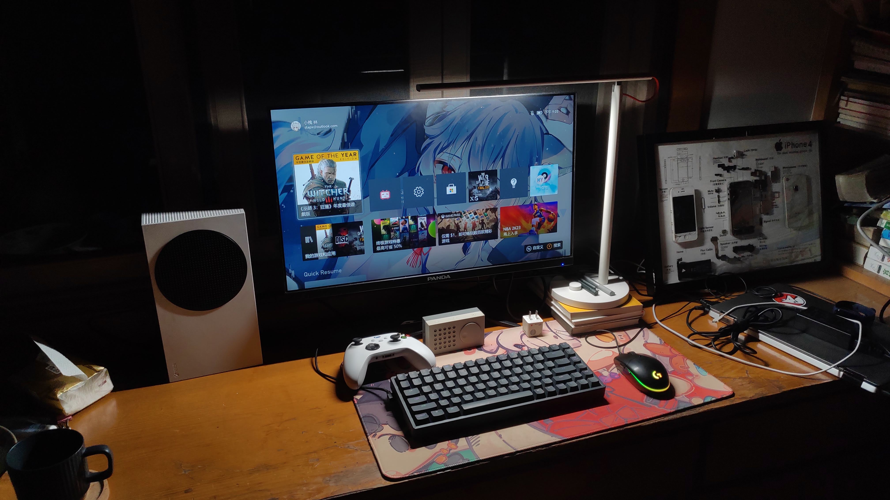

#### 坚果 Pro 4+32GB 炭黑色（二手）
八月，其实买他的时候我已经确定购置 14P 了。买它只是因为我一直想要一台 …… 我高中的时候其实有一台，但因为学校没收保存不当最终遗失，我当时一直想着之后要买一台，于是，就买了，就这样。
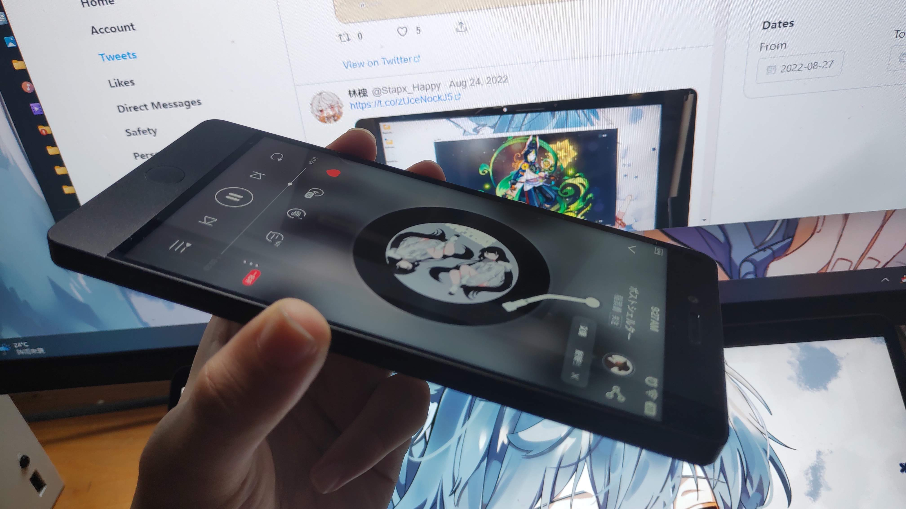
###### 怎么看都很漂亮的机器

#### iPhone 14 Pro 128GB 深空黑色
这是九月买的，来自我第一个月的工资和 24 期快乐免息分期，也完成了我一直想用自己工资换台 new iphone 的愿望。手机嘛毕竟只是工具，所以我对它其实没有什么特别的想说的 emmm 总之，很强，够我日常霍霍式的使用了。
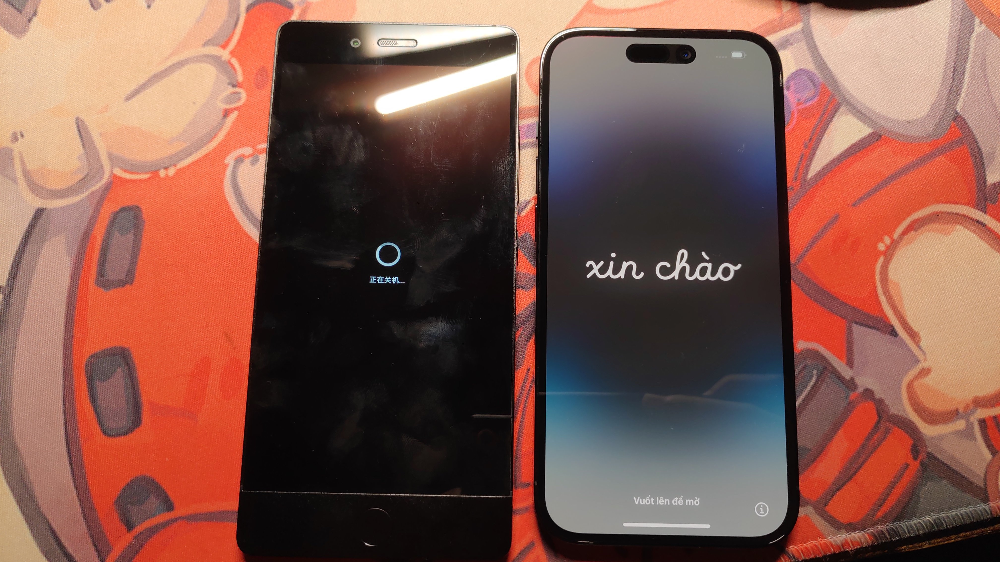

#### Apple Watch Serise 6 （二手）
光速集齐 Apple 全家桶（确信），这是十一月购入的。从狗东购买的二手机器，买它的目的其实不是很明确 XD 可能就只是用来记步数的（无端）。对自己细得只能用女式表的手腕有自知之明买了 40mm 的，还是很不错的。
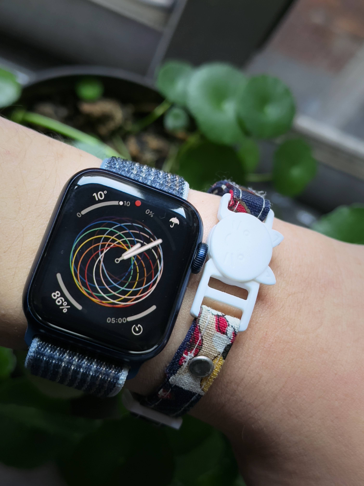

#### AirPods（第三代）
在十二月份的那个平常的下班 …… 我的小米真无线 Air2 充电盒彻底摆烂寄了，于是无奈（真的）。光速下单了 AirPods 来完成全家桶计划（x)，三期免息还有一期没还。对于一个重度干啥都要听音乐人，耳机还是刚需品的 …… 

### 项目
今年写的东西其实也不是特别多 …… 主要一直在摸同一个东西。比起大佬来说我这算是摸大鱼了 emmmm
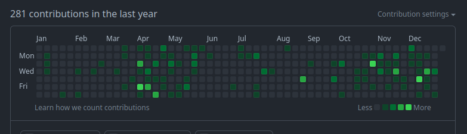

#### Fructose-Blog - 果糖博客
https://github.com/Stapxs/Fructose-Blog
这是二月份的毕业设计，一个很老套的博客系统。没啥好说的 XD，毕业设计嘛，摸 …… 都可以摸，总之整个毕业设计就是我拿来研究新的 UI 设计和新学到的前端技术用的，整个看起来就像是我拿来玩的（无端）

#### Stapxs QQ Lite
https://github.com/Stapxs/Stapxs-QQ-Lite-2.0
这是个第三方网页 QQ 客户端，我几乎全年都在开发和维护这个有两个大版本的项目，从四月份无意间说要做这东西开始。总之这个客户端一开始只是群友说要用一个更方便的 QQ 客户端而起，到现在我自己在 linux 上也用。因为这是我自己也在用的项目，所以遇到 bug 我自己也受不了得修，所以它一直都在我的活跃维护列表上 XD 总之如果你感兴趣可以去 github 页面看，至于相关文章我这几天也会写出来（会排在这篇前面）

#### BCUI for Typecho
https://github.com/Stapxs/BCUI-Typecho
这是上面毕业设计果糖博客的默认主题在 typecho 上的移植版，毕设虽然写得也能用，但是相比一个完善的博客系统还有很多细枝末节的功能没做，于是我的博客还是只能使用 typecho。于是我赶着年底把它移植到了这儿 —— 你现在看到的主题就是它，因为是赶工移植的，很多地方还没写完，先凑活着看啦 ——
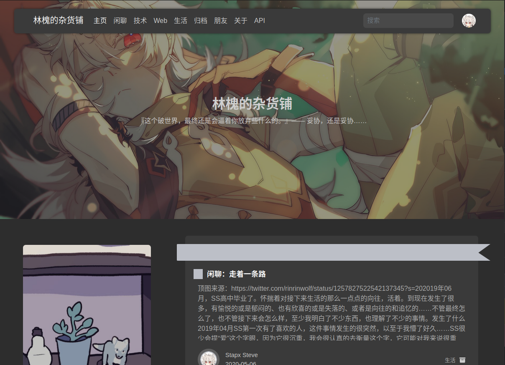

## 生活什么的，简单就好
因为有很奇怪的从小导致的社交恐惧，事实上我的生活很简单 …… 加上这几年疫情，简直可以用枯燥来说了。

六月九号我正式大学毕业，离开了我呆了三年的大学 …… 没错因为该死的疫情，大学期间我就没怎么出去玩过。因为是毕业年，其实这一年在大学的生活也算比较闲的，在宿舍呆着，以及在教室爆肝毕业设计。
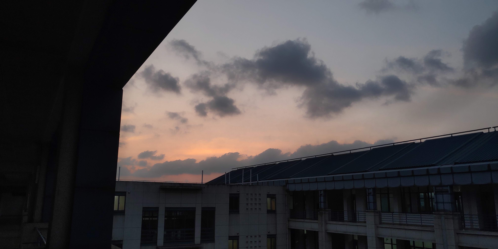
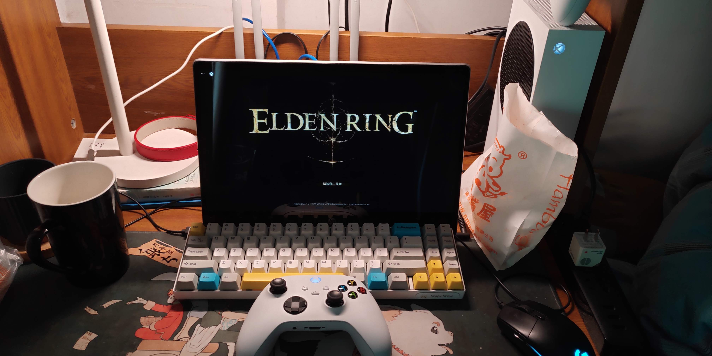
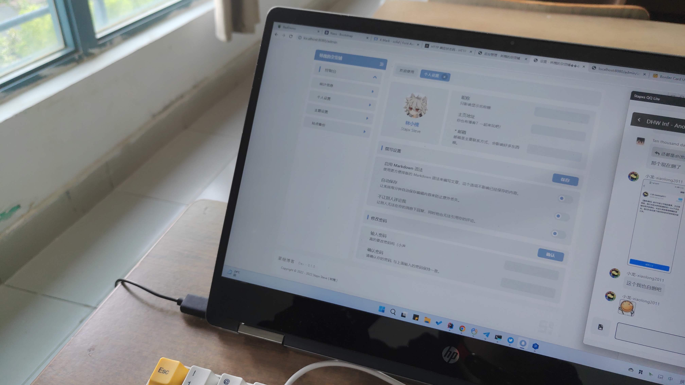

毕业之后我在家里呆了一阵子，在七月份我找到了一份后端开发的活便开始了比在学校还无聊的工作生活 ……
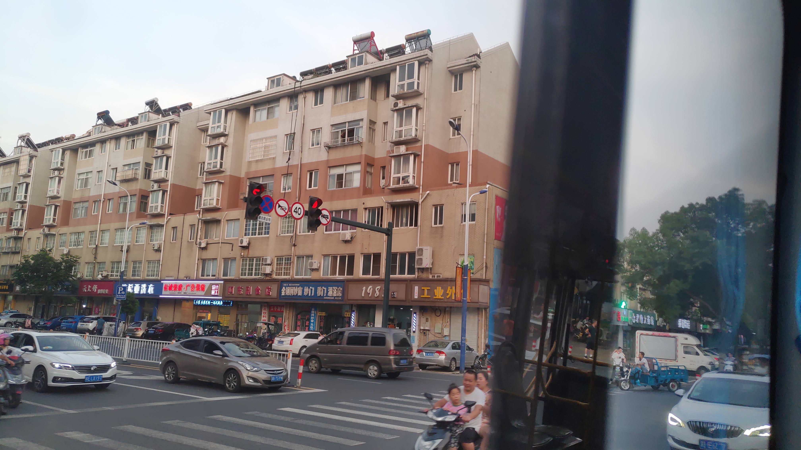
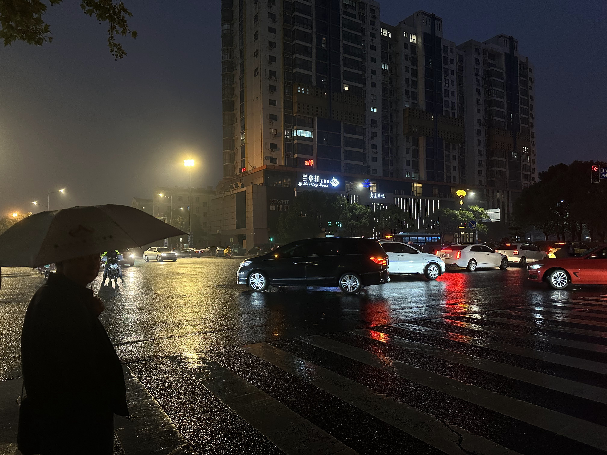
###### iOS 这个夜景锐化是真的猛
十二月二十三我成功的得上了 2019 冠状病毒病 …… 差一点就过年了（恼
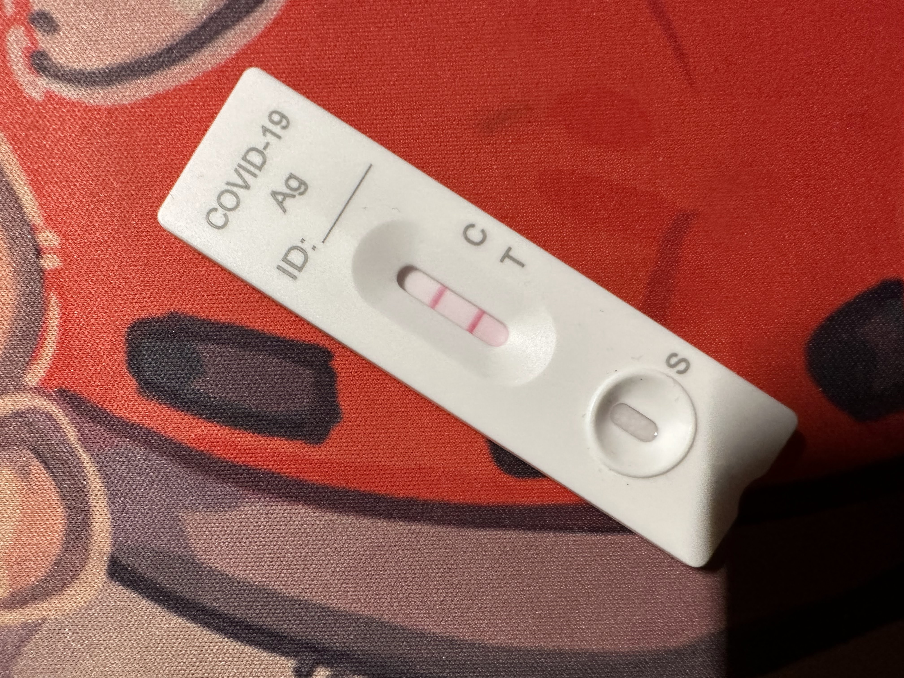

## 未来 …… 先想想就好了
有些事情已经计划要在 3202 年做了，像是这些：
- 写一个 n2s 第三方客户端，我们暂且叫它 n3s
- 继续更新 BCUI for Typecho，这玩意还有好多 bug 要修
- 软件设计师证书，这是五月份前需要完成的事情
- DHW INF 五周年的庆祝企划 …… 又是爆肝的计划，这事情要在九月之前弄完

还有一些想要学的东西：
- nodejs 后端，把重量级的 spring boot API 服务换成更轻的 nodejs
- Electron，想把 SQL2 打成更完善的桌面 APP
- Echarts，这是阿帕奇家的前端图表库，看着好炫酷.gif

## 新年快乐
总之 …… 2022 算是过去了。新年快乐！
