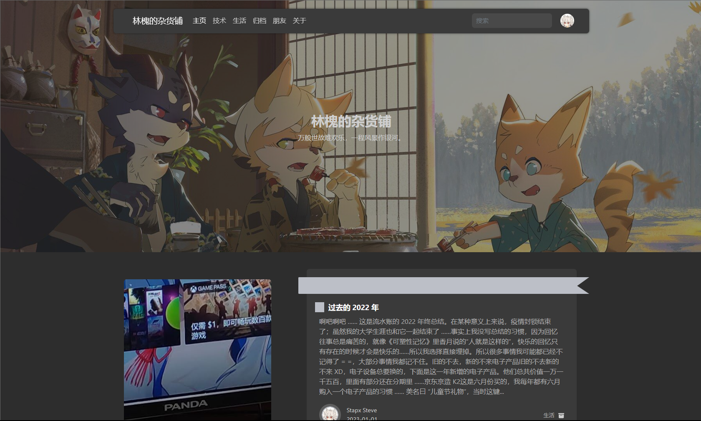
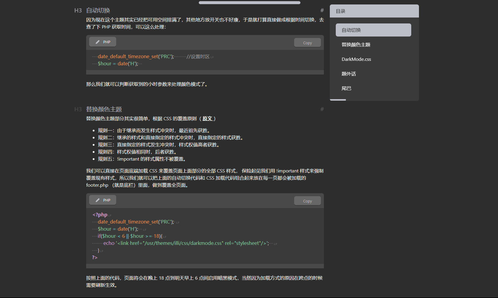
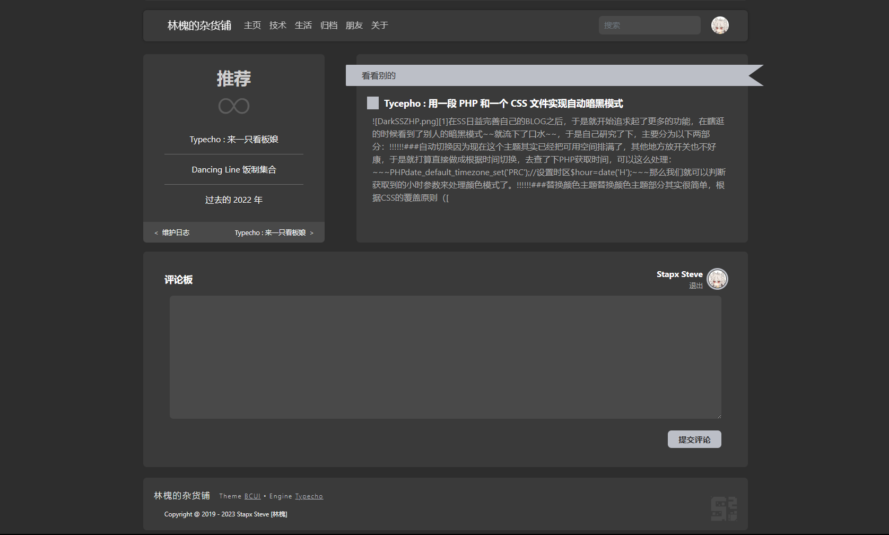
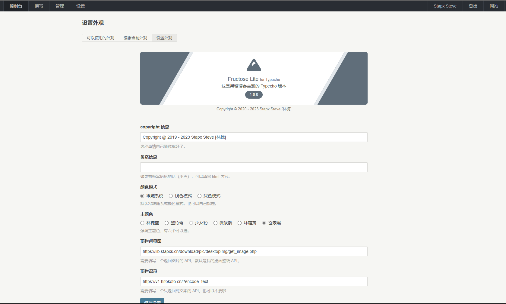
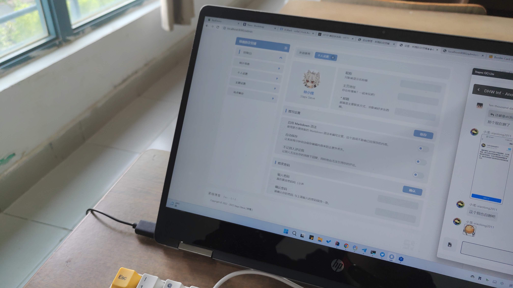

在 SS 进行如火如荼的全面 BCUI 化的进程中。Blog 也在劫难逃 —— 于是 Typecho 的 BCUI 主题也来啦！
这个主题其实来自于我的毕业设计，一个非常普通而又平凡的博客系统 …… 毕业设计嘛，懂得都懂基本上就是摸鱼出来的。这个主题也是我当时做新的设计风格和实现一些奇奇怪怪的功能的时候搓出来的（躺

### Border Card UI
什么是 BCUI？Border Card UI 是 SS 第一个使用的纯扁平化设计风格。在 2020 年的高三，我闲来无事买了本 WPF 开发的教程，便开始从简陋的控制台编程跨向了现代化的 UI 程序开发（其实在这之前我还学了 Windows API） 于是我想着要用什么东西练练手，于是 SS Tool Box 就出现了！
SSTB 经历了好几版的更新，还有好几版的界面设计更新，界面有些是自己设计的，有些可能直接来自 UI 库。 总之，在 2.0 的重置版里，我设计了一个全新的 UI，它就是现在的 Border Card UI。 为什么叫 Border Card UI？ 因为它在 WPF 中最早的实现方式依靠了大量的 Border 控件，于是我脑子一抽，就用 Border 做名字了 XD
后来，由于我开始转手到 Web 开发中，BCUI 也被我一路带到了各种我写的东西里，所以我经常将它们称之为 BCUI for something；在这儿，它就是 BCUI for Typecho 了！（当然由于它来自我的毕设博客，它还有个名字叫做：Fructose Lite）

### 样式和特点
- BCUI 的特点莫过于纯色填充，卡片和阴影以及完整的暗黑模式支持，同时 BCUI 在元素设计上也会有更大的间距和更柔和的边框样式 ……

- 更沉浸的阅读模式、侧边目录阅读进度以及 Code 和高亮支持（基于 Prism.js）还有完整的 TeX 数学表达式支持（虽然我好像用不太着）

- 简易的随机推荐、上下文章和分段式评论栏样式

- 齐全的个性化设置（还有好多功能没做）以及页面模板（还有好多没做）



### 获取和使用主题
https://github.com/Stapxs/BCUI-Typecho
你可以在这儿 —— Github 上下载到当前最新版本的主题文件，将它放置到网站的 ```/usr/themes``` 目录中即可。如果没有什么意外，你就可以在后台的 控制台 > 外观 中看见 Fructose Lite 主题了；启用它并且修改想要修改的设置就大功告成啦！

### And More？
众所周知 Typecho 的后台页面向来简单 …… 而我当初在制作毕设时也制作了一个更好看的后台设计：

或许等我有空了我会试着把它迁移到 Typecho 中 —— 制作 Typecho 后台主题的其实不是特别多，主要原因无非是：
- 后台主题需要整个更换掉 Admin 目录而没有主题系统支持
- 更换 Admin 目录需要承担因为可能的代码 BUG 导致的后台无法使用的风险
- 三方后台代码不一定安全

不过总之我写了也是自己用的（躺，不过有生之年.png，现在 BCUI 的主题都有很多很多 BUG 要修，手机端支持也一塌糊涂的 ……

### 更新日志
（暂时还没有 ……）
