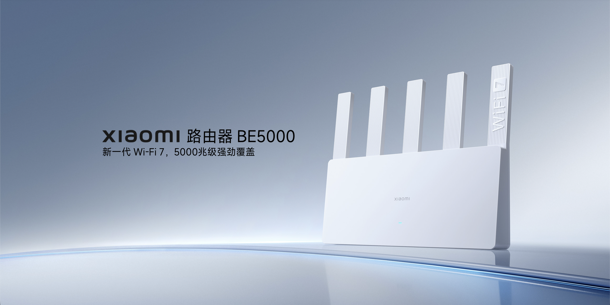
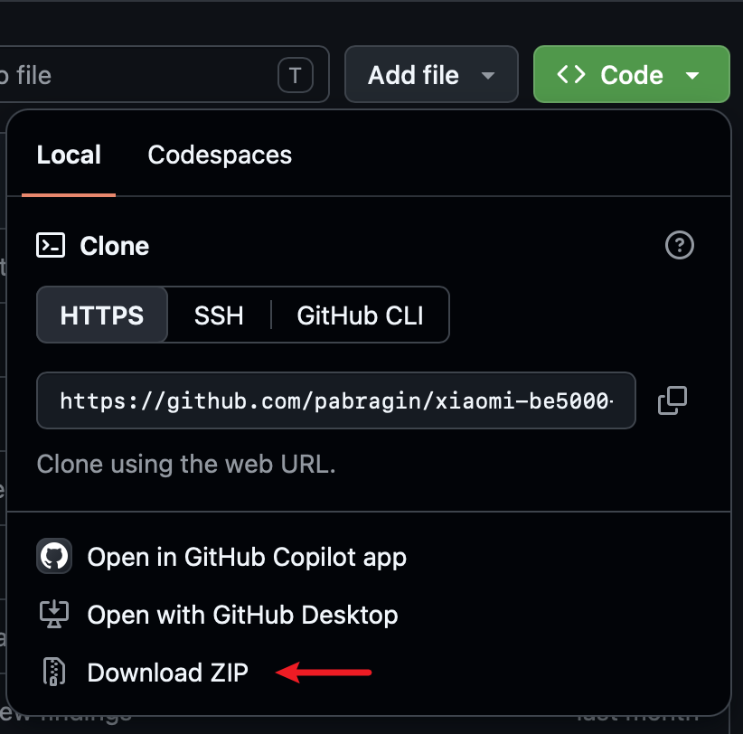
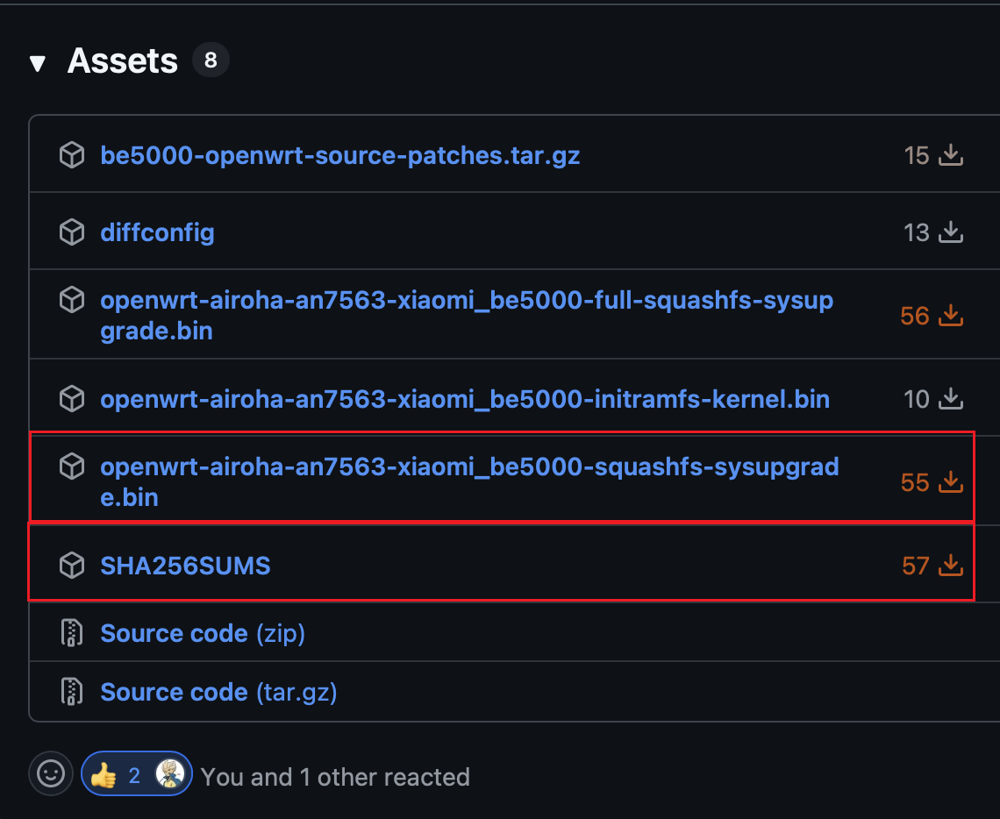
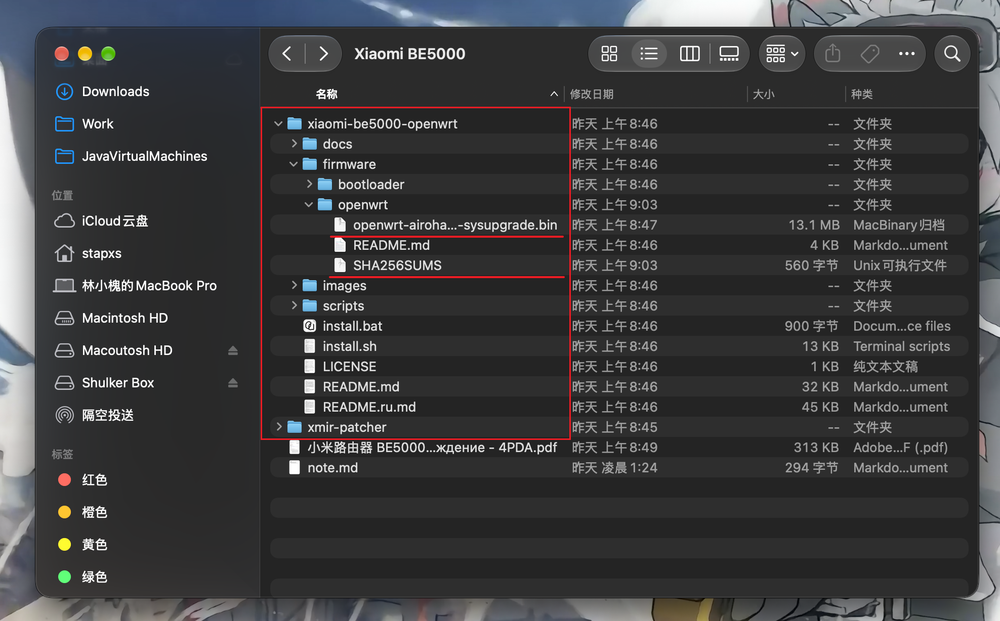
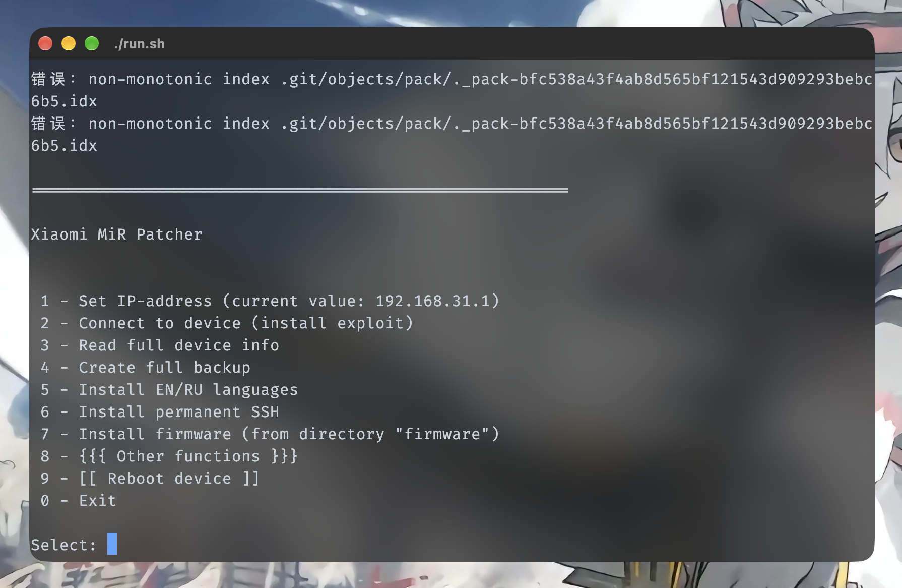
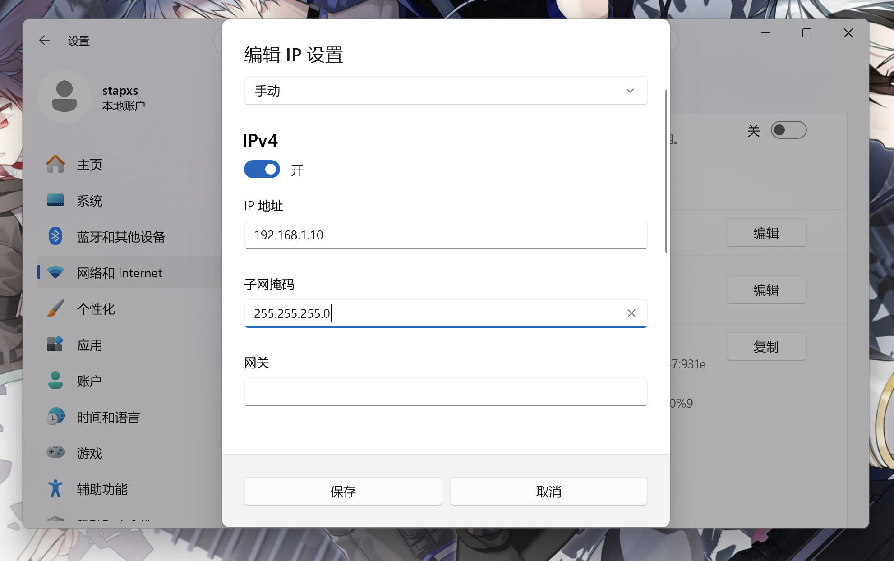
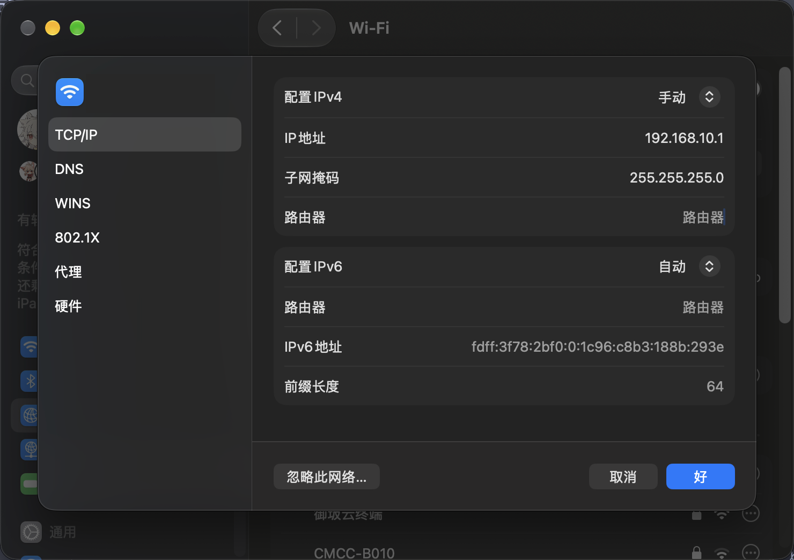
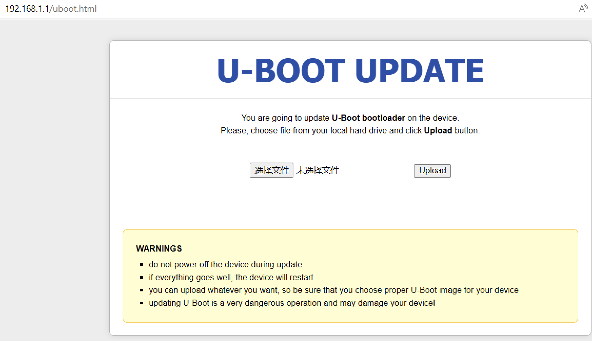
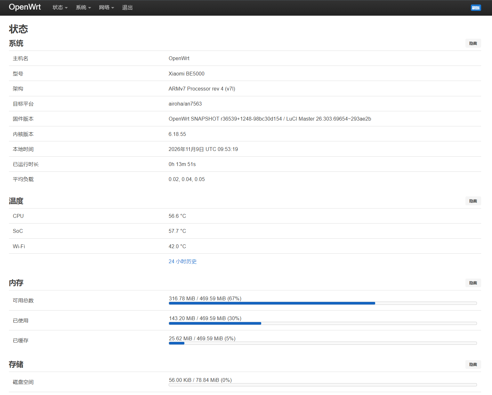

这是一篇关于小米路由器 BE5000安装 Openwrt 的简易文档。
## 开始之前
在你决定要为这台机器整个 Openwrt 之前，你需要了解一些东西：
1. 在你动手后你就没有办法通过简单的方式将它刷回原厂固件了，救砖以及刷回都需要额外的工具并拆机拆卸屏蔽罩
2. 小米的 Mesh 组网是私有协议，更换 Openwrt 后你将无法将它和其他小米路由器进行 Mesh 组网
3. 这台路由器的 CPU 性能略弱，可能无法稳定运行 AdGuard Home 等重型的插件

> [!CAUTION]
> 刷机属于高危行为，请务必谨慎操作。本文档不对刷机导致的设备损坏负责。
> 另：不要在晚上刷机，除非你晚上不想睡觉了.png

## 材料准备
在开始之前，我们需要准备两份代码和一份镜像以及对应的 SHA256SUMS 文件。

使用 git clone 或者下载 zip 的方式下载（并解压）以下两个仓库的代码，它们将在后续用于解锁 ssh 以及刷机。

{: class=right}

https://github.com/openwrt-xiaomi/xmir-patcher
https://github.com/pabragin/xiaomi-be5000-openwrt

接下来我们在 pabragin/xiaomi-be5000-openwrt 仓库的 releases 中下载最新的固件文件以及它的 SHA256SUMS 验证文件。
https://github.com/pabragin/xiaomi-be5000-openwrt/releases

你需要下载的文件包括：
- openwrt-airoha-an7563-xiaomi_be5000-squashfs-sysupgrade.bin
- SHA256SUMS

{: class=right}

如果你想要下载预装了 AmneziaWG、Xray 的镜像可以选择下载：
- openwrt-airoha-an7563-xiaomi_be5000-full-squashfs-sysupgrade.bin

最后，我们需要把下载好的 ```bin``` 文件和 ```SHA256SUMS``` 放入前面下载好的 ```xiaomi-be5000-openwrt``` 仓库文件的 ```firmware/openwrt``` 目录中。

至此，我们准备好了所有的用于刷机的文件，如下图。
<br><br>


## 环境准备
- xmir-pather 需要使用 python3 运行，你需要确保你的电脑中已经安装有 py3。
- U-Boot 刷入脚本在 Windows 上需要使用 git bash 来运行脚本，你需要确保安装了 git。

将路由器的 LAN 口通过网线连接到你的电脑，在后续的刷机过程中必须保证连接和供电稳定，意外断电可能导致无法开机并且要走更复杂的恢复流程恢复。

## 解锁 root ssh
在正式开始写入 bootloader 并刷写系统前，我们需要先通过漏洞解锁路由器的 ssh。

进入先前准备好的 xmir-pather 仓库目录中运行 ```run.bat```，linux 及 macOS 使用终端运行 ```run.sh```。



在 Xiaomi MiR Patcher 工具中，我们需要使用 1、2、6 三个选项。

### 设置路由器地址
首先，先确定路由器的地址，默认为 ```192.168.31.1```，你可以在浏览器中直接打开 ```http://192.168.31.1``` 打开路由器后台，打开并确定为本机则可以直接跳过本步骤。

如果你的路由器在其他地址上，在终端中输入 1，并填入路由器地址修改地址参数。

### 解锁 ssh
> [!IMPORTANT]
> 如果你在这个步骤遇到了一些报错，请跳转到文章末尾的 [Q&A](#qa) 检索问题。

接下来，在终端中输入 2 开始执行 ssh 解锁。在执行过程中，工具会要求你输入路由器后台的登录密码，正常输入即可。

如果一切顺利，你将会看到终端输出以下内容：
~~~shell
Enter device WEB password: 12345678
Exploit "start_binding" detected!
Run SSH server on port 22 ...
#### SSH server are activated！####
~~~

接下来你可以使用 ssh 工具（像是 Xtream）或者直接在终端中连接路由器的 ssh 进行检查：
~~~shell
ssh root@192.168.31.1
~~~
密码同样为 root，如果没有意外，你将正常连接到路由器并输出小米路由器系统的内部代号 XiaoQiang 以及 are u ok 梗：
~~~txt
Enter 'help' for a list of built-in commands.

 -----------------------------------------------------
       Welcome to XiaoQiang!
 -----------------------------------------------------
  $$$$$$\  $$$$$$$\  $$$$$$$$\      $$\      $$\        $$$$$$\  $$\   $$\
 $$  __$$\ $$  __$$\ $$  _____|     $$ |     $$ |      $$  __$$\ $$ | $$  |
 $$ /  $$ |$$ |  $$ |$$ |           $$ |     $$ |      $$ /  $$ |$$ |$$  /
 $$$$$$$$ |$$$$$$$  |$$$$$\         $$ |     $$ |      $$ |  $$ |$$$$$  /
 $$  __$$ |$$  __$$< $$  __|        $$ |     $$ |      $$ |  $$ |$$  $$<
 $$ |  $$ |$$ |  $$ |$$ |           $$ |     $$ |      $$ |  $$ |$$ |\$$\
 $$ |  $$ |$$ |  $$ |$$$$$$$$\       $$$$$$$$$  |       $$$$$$  |$$ | \$$\
 \__|  \__|\__|  \__|\________|      \_________/        \______/ \__|  \__|

are u ok
~~~

### 固化 ssh
在检查完 shell 确保解锁 ssh 顺利后，我们回到 Xiaomi MiR Patcher 工具中执行 6 操作对 ssh 破解进行固化操作，避免 ssh 解锁在重启后失效。

## 刷入 Bootloader
> [!IMPORTANT]
> 如果你在这个步骤遇到了一些报错，请跳转到文章末尾的 [Q&A](#qa) 检索问题。

接下来我们需要刷入 U-Boot 为接下来刷入固件做准备，同时 U-Boot 也能为刷入固件异常兜底。

打开 git bash（linux 和 macOS 直接使用终端），进入先前准备好的 ```xiaomi-be5000-openwrt``` 目录并运行对应的命令，如果你的路由器不在默认地址上记得修改地址：
~~~shell
# Linux / macOS
sh install.sh root@192.168.31.1
# Windows
install.bat root@192.168.31.1
~~~

如果没有遇到问题，刷入脚本执行完成后将提醒你机器正在重启，重启大概在一两分钟后就会完成。（忘记截图了这儿没有截图）

## 刷写固件
> [!IMPORTANT]
> 如果你在这个步骤遇到了一些报错，请跳转到文章末尾的 [Q&A](#qa) 检索问题。

由于 U-Boot WebUI 并没有 DHCP 服务，下面需要使用静态 IP 来连接它；依旧保持路由器的 LAN 口连接电脑，为了防止意外，如果有其他的联网方式（如 Wifi）可以考虑先断开。
将 IPV4 静态 IP 设置为 ```192.168.10.1```，子网掩码设置为 ```255.255.255.0```。
- Windows：设置-网络和 Internet-以太网-IP 分配

  

- macOS：系统设置-网络-（对应的适配器）-详细信息-TCP/IP

  

- linux：我没有 linux 但是你应该知道要怎么改.png

总之，如果没有意外的话，你就可以在浏览器里使用 ```http://192.168.1.1``` 打开 U-Boot 来刷写固件了！


在 U-Boot 中选择我们之前准备在 ```xiaomi-be5000-openwrt/firmware/openwrt``` 中的 bin 文件开始愉快的刷机——吧。
执行到这一步一般情况下不太会出现别的什么意外了。（除非你下错了包）

刷机完成后设备将自动重启，重启大概在 5 分钟左右就会完成，你可以在这之前取消掉静态 IP 的设置。

## 大功告成
在设备重启完成后，你可以通过 ```http://192.168.1.1``` 打开 openwrt 后台，完成基本设置后就可以正常使用了！


## Q&A
<details>
  <summary>解锁 ssh 过程中遇到报错：You need to make the initial configuration in the WEB of the device!</summary>
  工具提醒你需要先完成设备初始化的操作，你可以先进管理后台完成初始化工作后重试。
</details>
<details>
  <summary>Windows 执行 Bootloader 刷入时报错：STOP: ssh is not installed on this computer</summary>

  脚本可能没有找到 UGRT64 环境中的 ssh，尝试直接使用下面的命令直接运行安装脚本：
  ~~~bash
  BE5000_NO_PAUSE=1 sh install.sh root@192.168.31.1
  ~~~
  
</details>
<details>
  <summary>在刷写固件前：我没法打开 http://192.168.1.1</summary>
  确保路由器的 LAN 口连接在你的电脑上（不是 2.5G WAN 口），这台设备有三个 LAN 口，你也可以换一个口插。
</details>
<details>
  <summary>其他：我该如何重新进入 U-Boot WebUI</summary>
  在路由器开机时按住 reset 键即可进入恢复模式，使用之前的方式通过静态 IP 打开 U-Boot WebUI 即可。
</details>
<details>
  <summary>其他：我完全搞砸了 😭</summary>

  如果你真的在刷写 U-Boot 的时候意外断电了或者真的确定连 U-Boot 也进不去了，请参考 xiaomi-be5000-openwrt 仓库提供的恢复指南：https://github.com/pabragin/xiaomi-be5000-openwrt/blob/main/docs/en/recovery-uart.md ，由于我也没有试过 XD，可能需要你自己摸索了。
  
</details>

## 参考内容
- [方案来源论坛](https://4pda.to/forum/index.php?showtopic=1088946&st=2720)
- [xiaomi-be5000-openwrt - 固件及相关脚本](https://github.com/pabragin/xiaomi-be5000-openwrt)
- [xmir-patcher - ssh 解锁及相关脚本](https://github.com/openwrt-xiaomi/xmir-patcher)
