在上一年的九月份，SS 购入了一台 Mac Book Pro 并开始替换作为主力机器使用。众所周知有句“苹果自适应用户”的玩笑，总之为了体验上的优化倒腾了许多奇奇怪怪的软件和工具；所以这篇文章简单的说就是个软件推荐（趴

## 关于硬件
在说软件之前还是要吐槽一下硬件 …… 如果你用 MBP 是开发用的，那么 Docker 和 Windows 虚拟机（甚至是 Linux 虚拟机）是在所难免的：加内存——加内存——；虽然果子金子做的内存，但是 16GB 真的有点拘束，不然就是内存不够硬盘寿命来凑了 XD
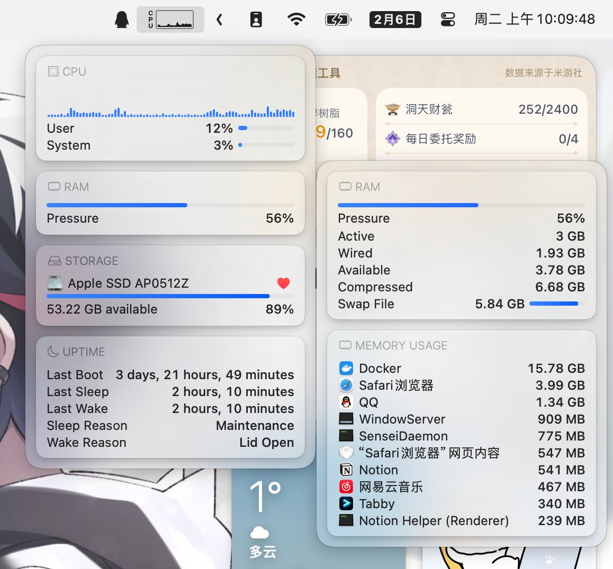
至于硬盘，毕竟是雷雳3，实在不够可以外接来找补，统一内存是和 CPU 封装在一起的买了就是死的了（瘫

## 基本体验
这部分主要解决鼠标、键盘的部分设置，来为了兼容部分 Windows 的操作习惯。

### 自然滚动翻转
在之前的操作习惯中，我们通常在使用鼠标时向上滚动页面向上、使用触控板时向上滚动页面向上；而在 Mac OS 中它俩是同步的（就是说开了自然滚动就都是向上，关了就都是向下）。
解决方法就是用这玩意单独翻转一下鼠标的滚动就好了（x
https://github.com/pilotmoon/Scroll-Reverser
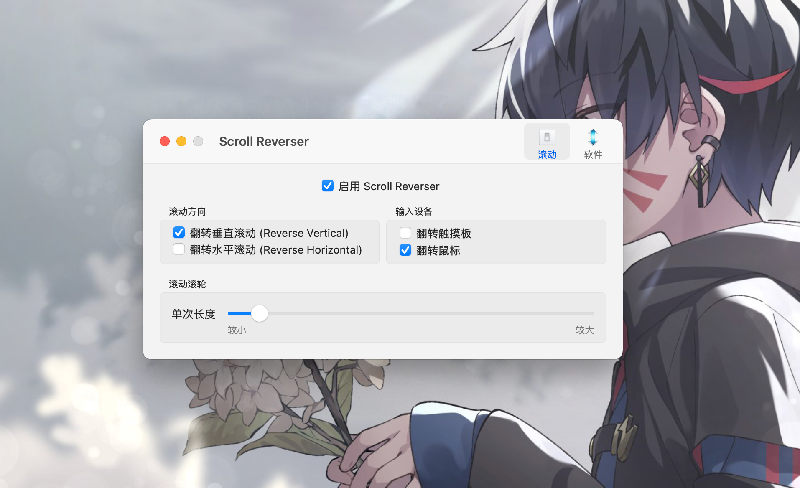

### 键盘禁用、大写锁定同步
这个主要解决外接键盘的问题，如果你有把键盘放在 C 面但是会压到 C 面键盘的问题就可以用它（
同步状态指示灯以及在指定设备连接的时候禁用内置键盘的功能都可以用它设置——
当然它还不止这些功能，如果你打算把 Mac 的键盘习惯改成 Windows 的（而不是像我一样把 Windows 的键盘习惯改成 Mac 的），它也支持键盘映射。
https://github.com/pqrs-org/Karabiner-Elements
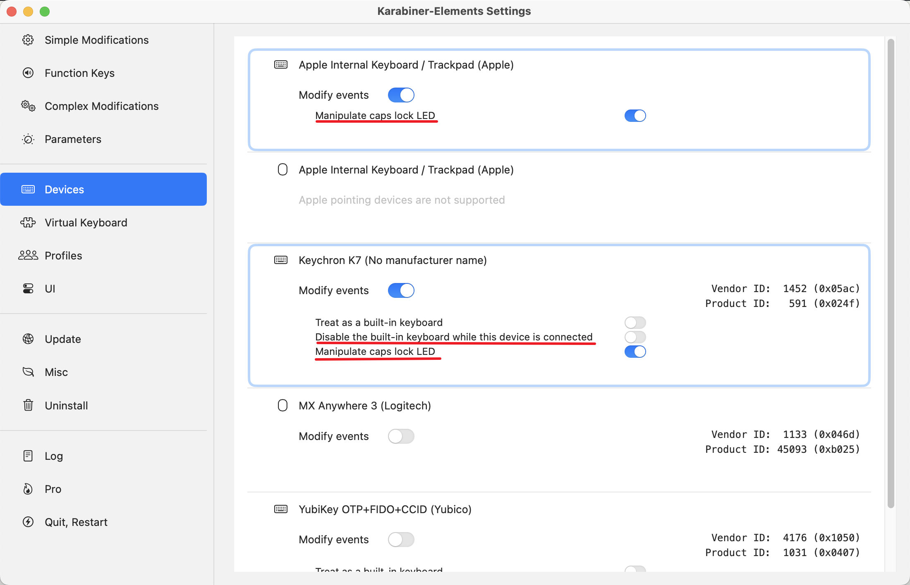

## 托盘优化
在新模(mu)具的 Mac 上，Apple 想不开的加了个刘海；这导致菜单在过多的情况下会严重侵占托盘区域，而托盘在过多的时候会直接被隐藏掉 ……
这儿主要解决两个问题：不想显示的图标（应用本身没有隐藏托盘的选项），以及折叠托盘。

### 折叠托盘
这玩意有不少选择，我在用 Hidden Bar。用它的原因主要是它比较原生.png
或者全都用下面隐藏托盘的东西，它也有类似的功能。
https://github.com/dwarvesf/hidden
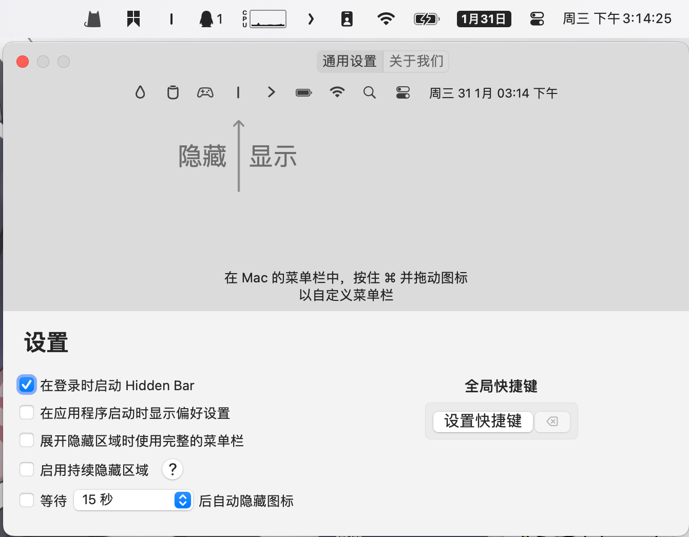

由于托盘图标有时候很多或者有很占地方的东西，光靠展开收起依旧没法完整的显示它们；后面我换用了类似 Windows 托盘的工具 Ice：
https://github.com/jordanbaird/Ice
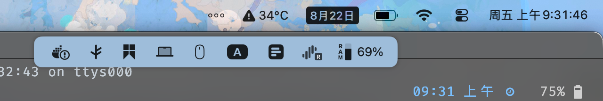

### 隐藏托盘图标
> [!TIP]
> 在 macOS 26 Tahoe 后，可以对所有托盘图标进行是否显示的设置，所以就不太需要这个功能了

有些应用的托盘图标不能隐藏，就只能想办法借助别的工具了——
当然上面的 Hidden Bar 也有这个功能（但是不好用），总之这边我分成了两个软件来解决这些烦恼。
这边我选择了 Bartender 5，当然有个坏消息：不开源而且收费；当然，由于它要截图抓取图标，所以会申请录屏权限，有些人会担心隐私问题，这个自己权衡啦。
如果不乐意的话还是用 Hidden Bar 好了。
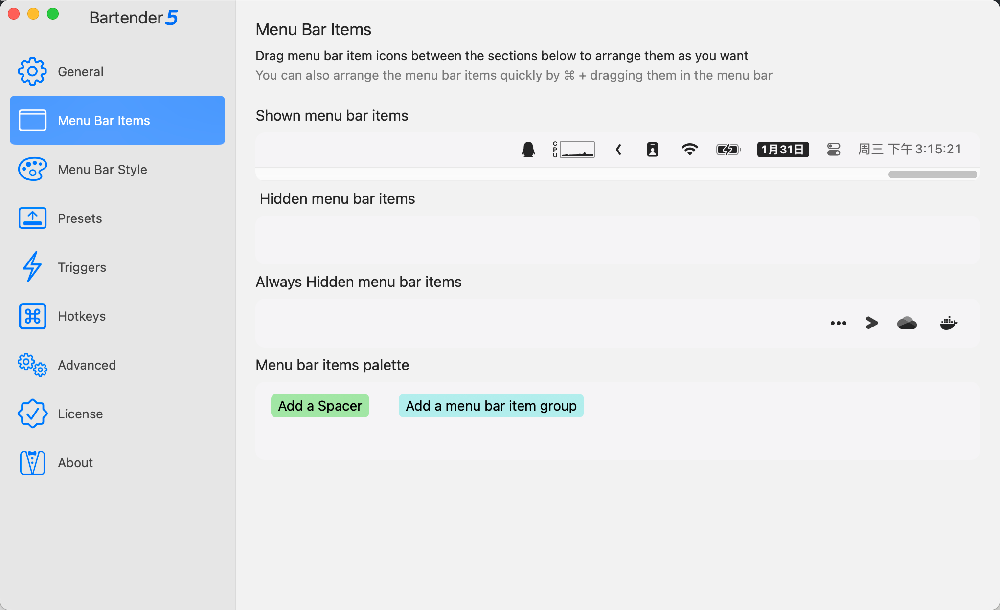

## 文字和图片操作
这是一些刚需或者不刚需的文本操作需要用到的东西，包括剪贴板、全局翻译、截图之类的东西。

### 剪贴板
Windows 有剪贴板，一直以来都用习惯了 …… 换 Linux 那边 gnome 也有插件；但是跑 MacOS 这边就很痛苦……目前在用 Cliipy，是日本人开发的软件呢，突出一个简洁；除了有时候会意外丢失复制的内容，都还 OK。
https://github.com/Clipy/Clipy
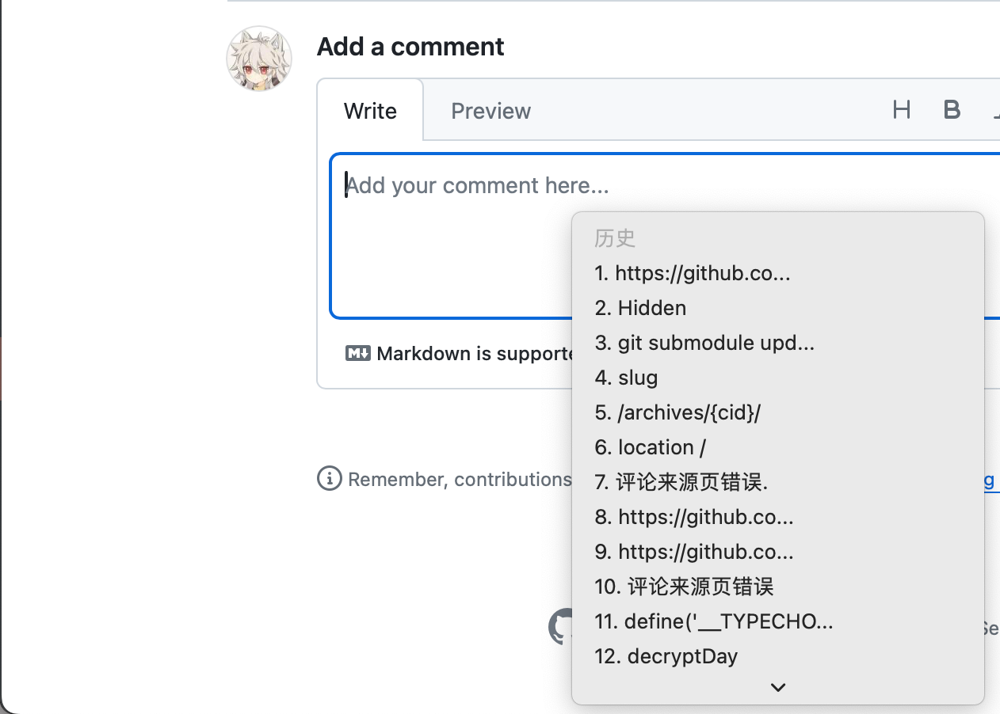

后面我换用的功能更全面的 Maccy，总之这俩都是不错的.png
https://github.com/p0deje/Maccy
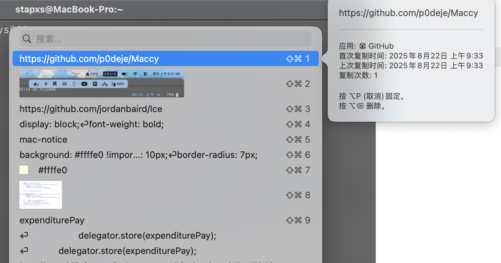

### 截图
截图工具可选的就没有多少了，ShareX 和抄袭 Snipaste 的 PixPin 都 Windows Only。可能有些人乐意用 QQ 和微信都截图，那就无所谓了（瘫
总之，在这儿！只有一个胜利者就是全平台的 Snipaste，不过不开源。
https://github.com/Snipaste/feedback

### gif 录制
Windows 下 Screen To GIF 的替代品。
https://github.com/wulkano/Kap

### 全局翻译和 OCR
这俩都是用的 Bob，同样不开源。
收费免费版限制次数；但是如果你的使用率很低（像我这样），那其实倒也无所谓这样。（系统翻译调用失败是新版本系统的 BUG）
总之它很好用，如果真的那么需要，收费可能稍微有点贵啦……
https://github.com/ripperhe/Bob
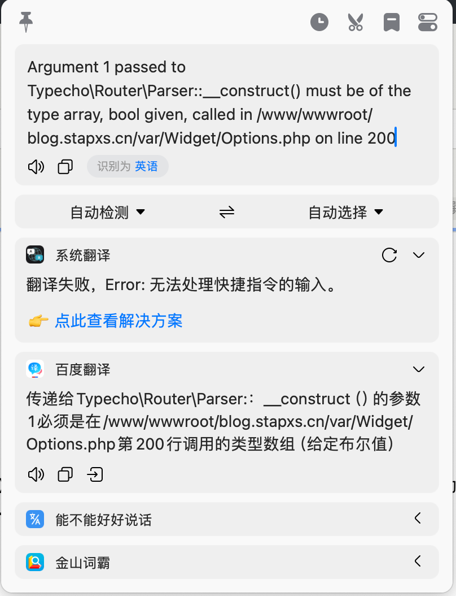

### 选中工具栏
这是为了配合 Bob 使用的，说白了这就是个选中操作栏。当然它在有些地方不能用这样 emmm，比如 idea，可能是因为它不是标准的输入框。
不过就是，收费软件咯。
https://www.popclip.app
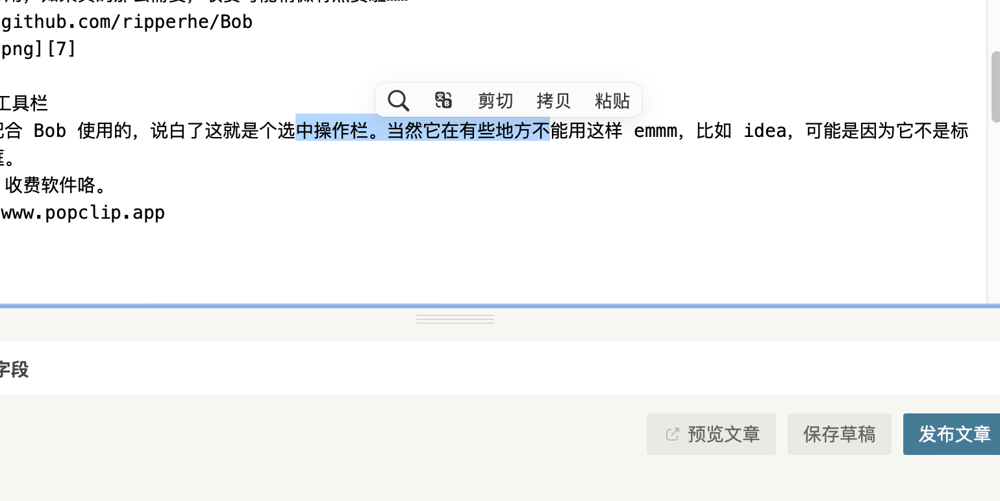

## 终端
不是所有人都需要用终端 emmmm 但是 MacOS 的终端真的很丑……
这个终端是全平台的 XD，所以其实放着这儿说不太好，但是它确实挺好用的就是了。能记录 ssh 配置、完整的 ssh 连接选项、sftp 界面、ssh 端口转发界面，完美（x
https://github.com/Eugeny/tabby
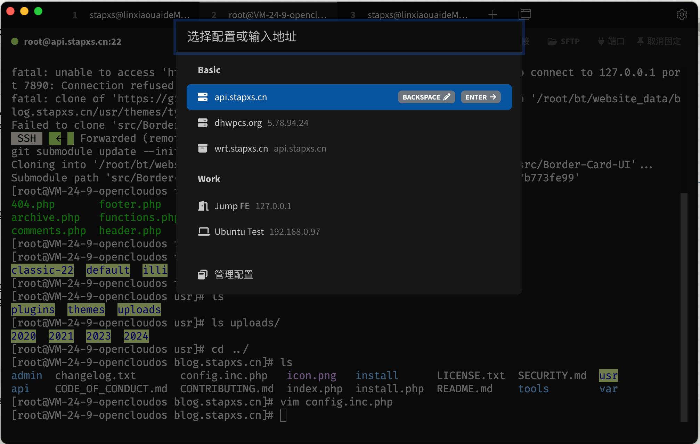

如果你是终端原教主义，就只想要一个终端；那推荐 kitty！自定义功能非常完善的一个终端，但是就只是个终端.png
https://github.com/kovidgoyal/kitty
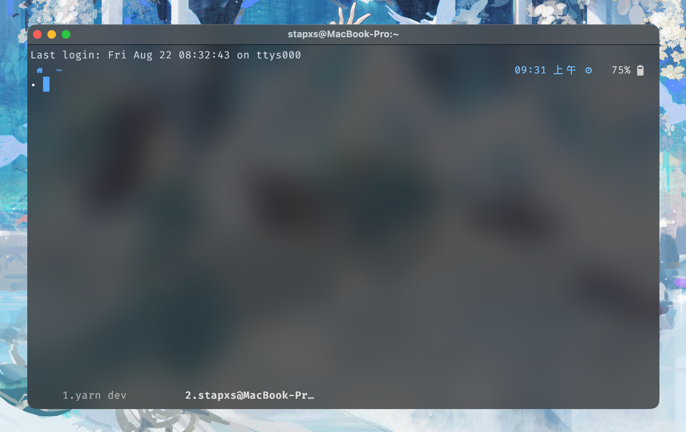
如果你想用我的配置，可以看这里：https://gist.github.com/Stapxs/de89be4789fa6a448b33f22331e613ba

#### zsh 插件
这儿是一些 zsh 的插件，如果你装了 Oh My Zsh 换用了 zsh 或许有用呢，只是顺便说一下如果你需要的话：
https://github.com/zsh-users/zsh-autosuggestions
https://github.com/zsh-users/zsh-syntax-highlighting

## 杂项
剩下的乱七八糟的东西 XD

### 日历
为啥果子不给托盘日期做个可以直接点开来的弹窗日历……
https://github.com/sfsam/Itsycal
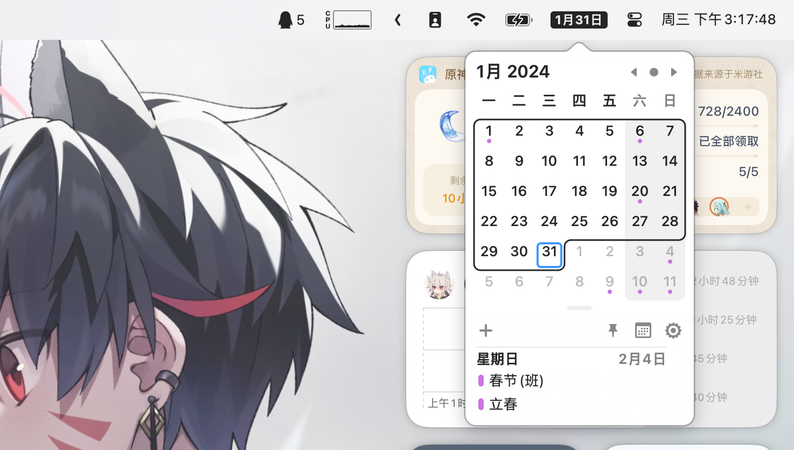
又发现了一个更好看的替代品，不过托盘文字会更大一点（趴
总之喜欢哪个用哪个啦
https://github.com/pakerwreah/Calendr
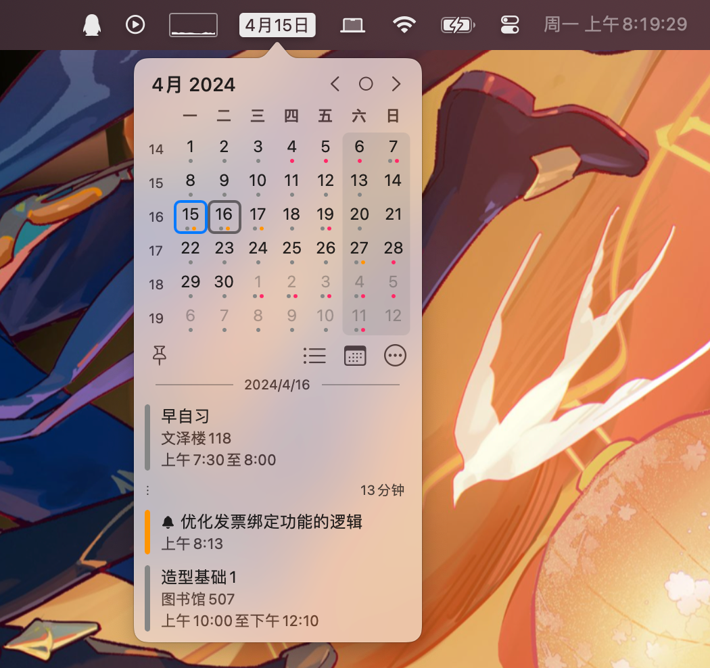

### 窗口切换
macOS 自带的 command+tab 的窗口切换器功能比较简单也没有窗口预览，如果经常用这玩意想功能更完整一点可以用这个替代品：
https://github.com/lwouis/alt-tab-macos
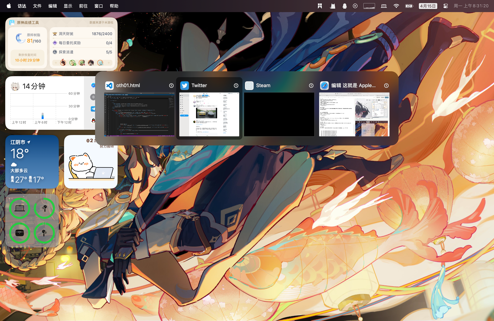

### 性能监控和软件管理
收费软件，我用来显示托盘的性能监控以及卸载软件；它也能开启硬盘 Trim 功能。
https://cindori.com/sensei
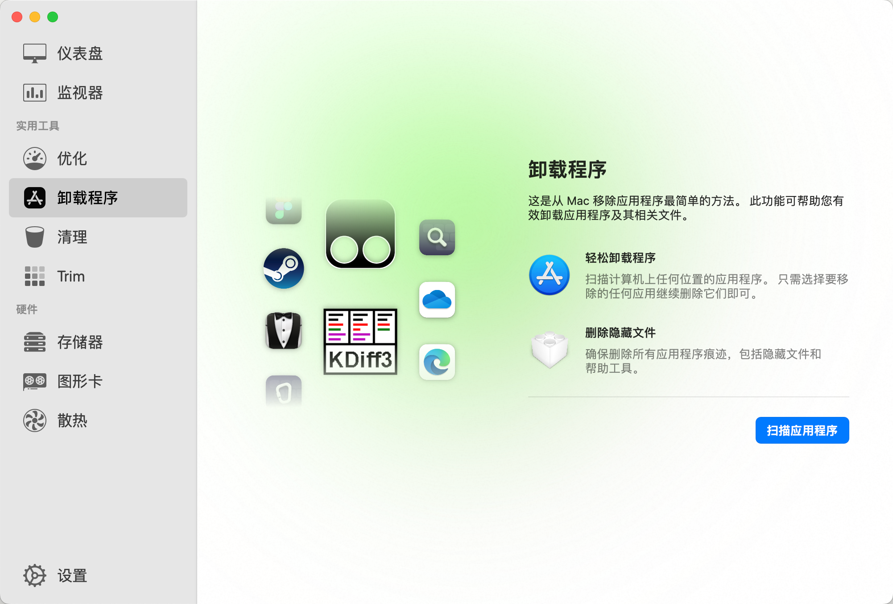

### 硬盘扫描
收费软件，Windows 下 WinDirStat、Linux 下 Filelight 的替代品，用来手动删垃圾这样。
https://daisydiskapp.com
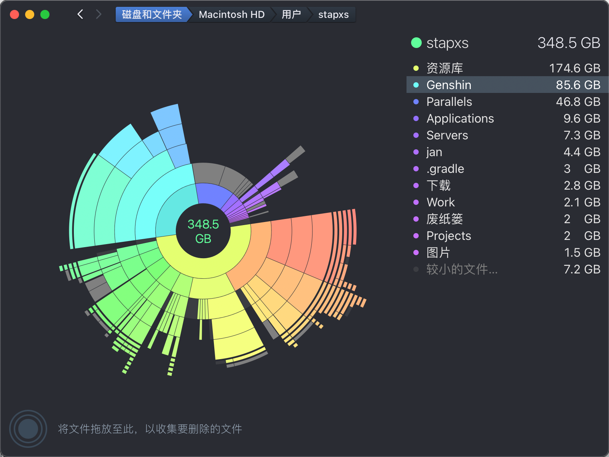

### 原神，启动！
这是个基于 Wine 的全平台原神第三方启动器，不过根据协议不能在这边放链接，可以自己去 Github 搜 yaagl 就是了。

## 啊吧啊吧
总之，为了有一个良好的使用体验满地找了一大坨软件来解决一些琐碎的需求；总之，爽了（瘫
