在我开学前，Minecraft BE 版 RTX 的版本就已经发布了 Bata 版本，因为当时我手头并没有支持 nVidia RTX 的设备，于是让 [@chuhelan][1] 给开了下眼界， 这是 [他的文章][2] 。于是现在快乐的开学了，迫不及待的上手了下 ——

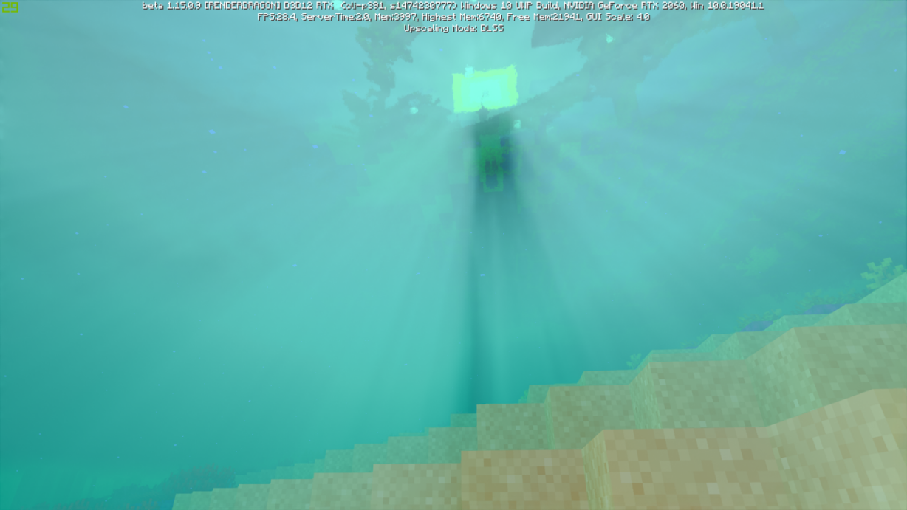

### 比较
意思一下的给几张图比较一下（逃

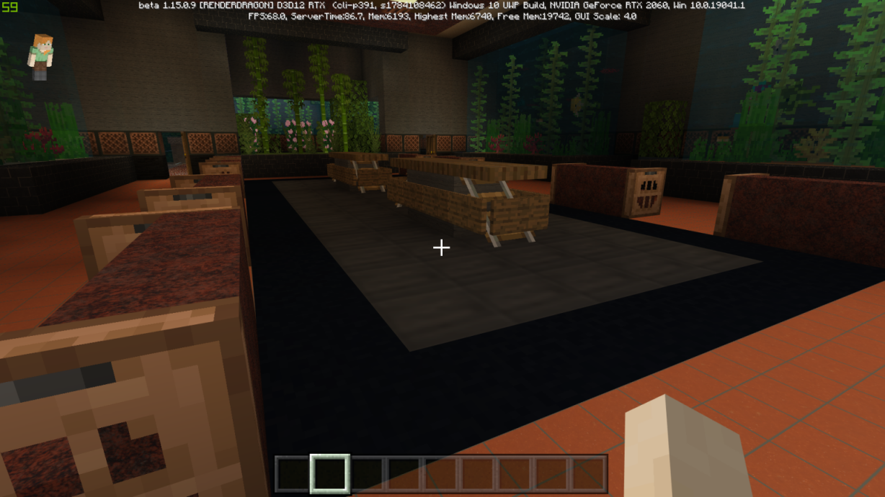

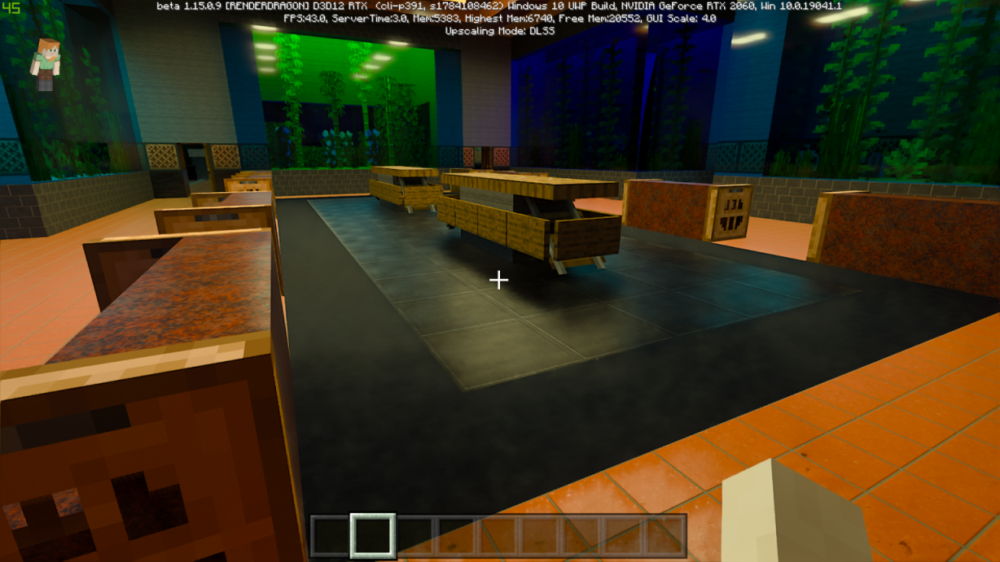

--------------------

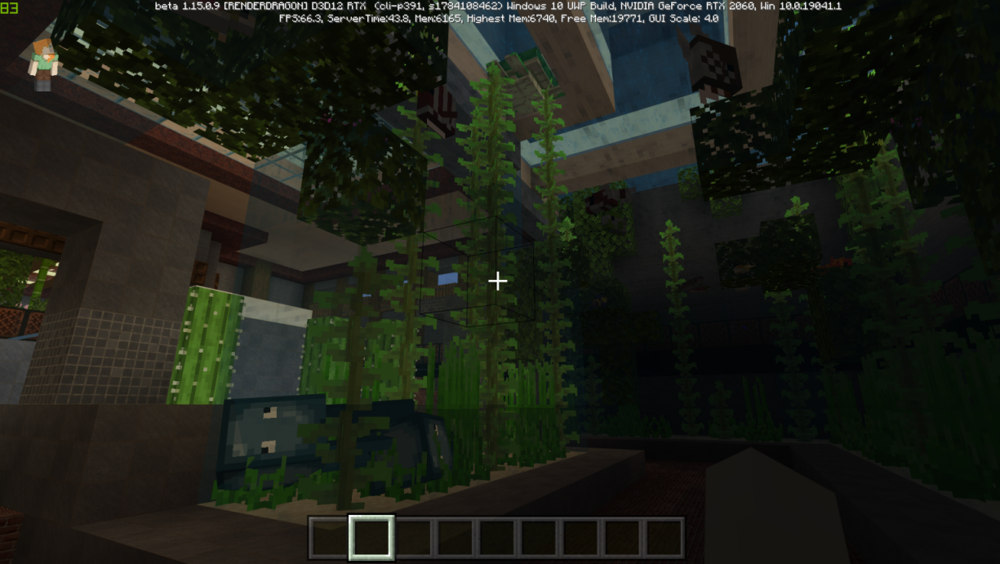

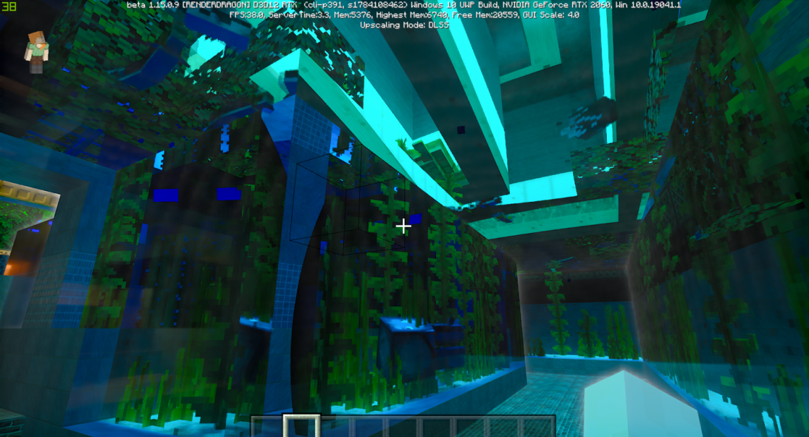

### 优点
由于来自 RTX 的加持，所以在 Minecraft BE RTX 中有了非常显著的漫反射提升、实时光线渲染提升和环境光混合提升。

由于 MOJANG 并没有提供或者可能还没有制作高光和法线纹理的加载，导致漫反射所提供的效果大打折扣，这意味着你看不到材质的凹凸以及不均匀反光，这些功能或许需要不少的精力去制作，希望在将来的更新里可以提供这些功能。

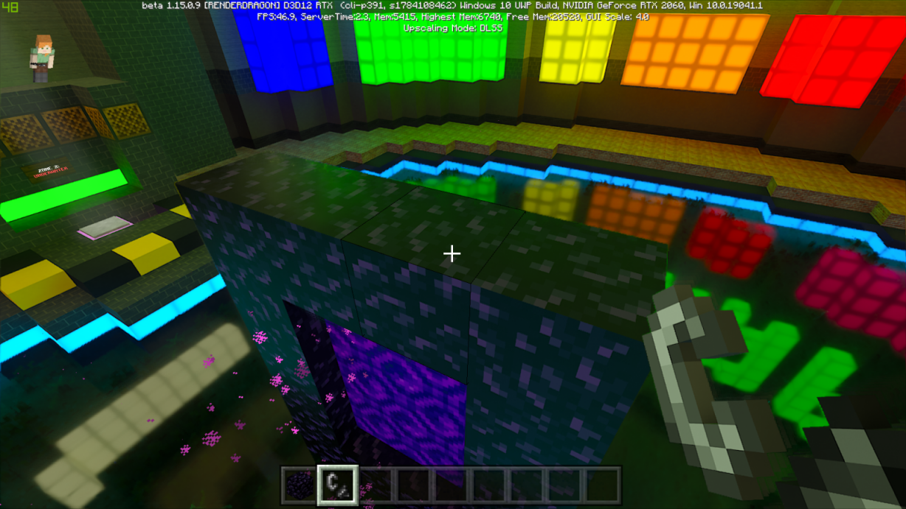
###### 有着复杂纹理的黑曜石依旧是平滑漫反射

在光照系统中有一个光线效果叫做模拟丁达尔效应（Tyndall effect）的效果，有时候也叫成“上帝光”，也就是当一束光线透过胶体，从入射光的垂直方向可以观察到胶体里出现的一条光亮的“通路”的效果。在这版更新的测试地图中用了不少笔墨来展示这个效果，但是个人认为此效果做的太过于强和突出，不够柔和，希望之后可以调整相关参数。

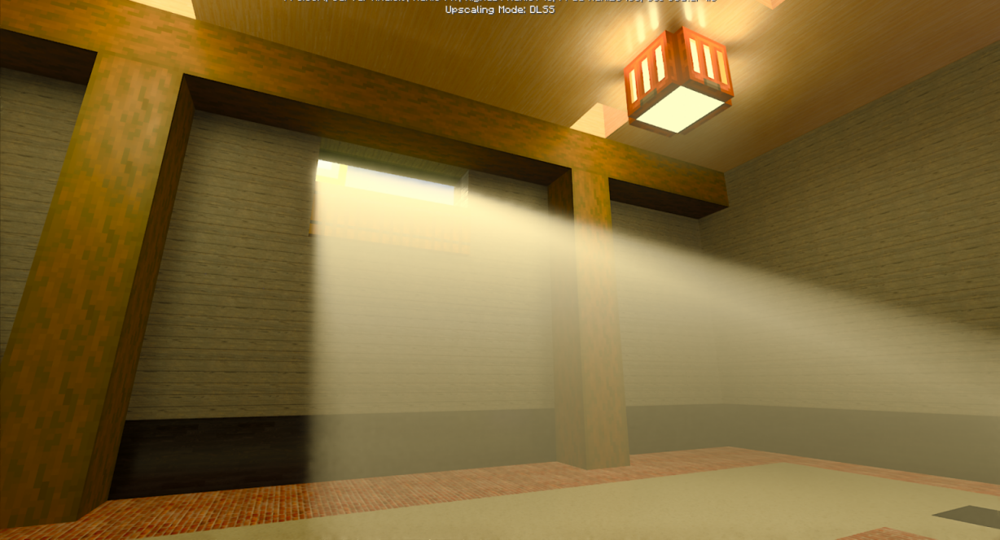
###### “上帝光”

在 nVidia 对 RTX 的宣传中，大力宣传的“实时光线追踪”在实际游戏中的体现就是各种更加真实的光照渲染和光源混合，我们可以用白盒来观察。

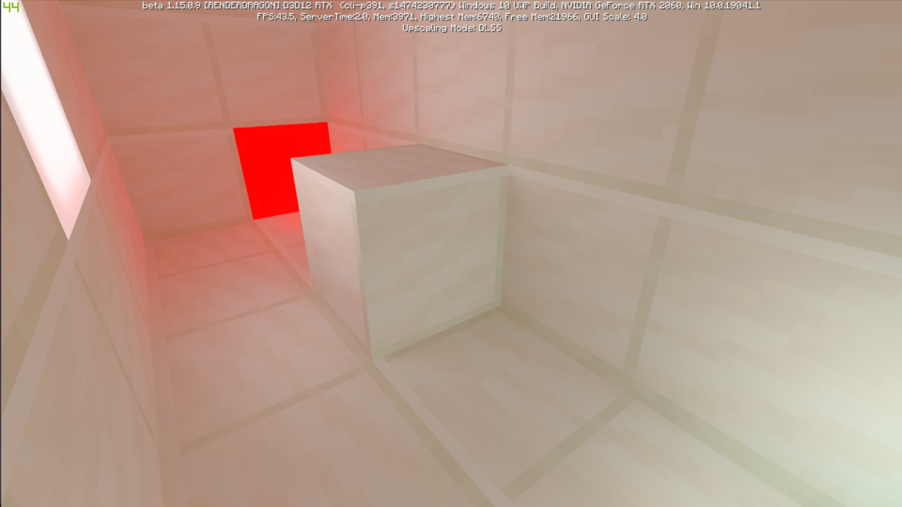
###### 光源混合

同时在演示地图内还有不少区域对镜面反射进行了展示，对于镜子对镜子的情况，看起来 MOJANG 貌似只处理了六次反射后以黑色进行填充，其实我觉得以一个模糊处理会比较好。

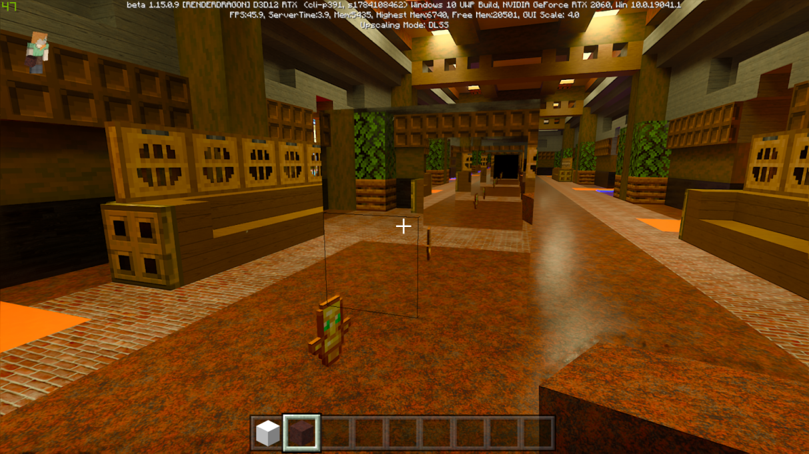
###### 镜面反射

### 缺点
在展示了一些 RTX 加持的优点之后依旧需要说一些缺点。
首先就是上面提到的高光和法线贴图以及水面，这是个优质光影材质必备的功能和效果，其次就是从外部向水下观看的效果，水下缺少阴影导致深度和层次感不明显，甚至给我带来了水下的东西和水面是在同一平面的错觉。

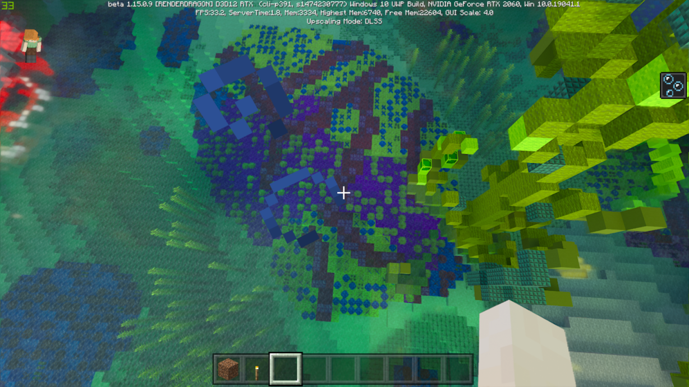
###### 水面

接下来是关于变化的重渲染，虽然说目前还是在完成度较低的 Bata 版，但是在光影变化时出现的渲染处理马赛克依旧需要被注意到。

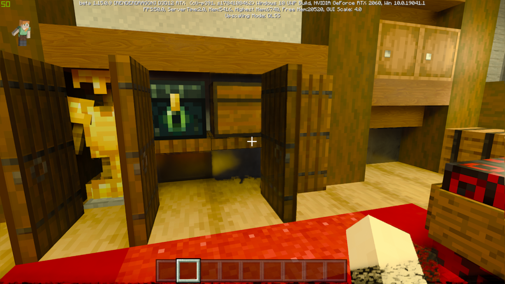
###### 注意手的位置和箱子下方

### 总结
这次 Minecraft 和 nVidia RTX 技术的结合，毋庸置疑的将 MC 的效果抬上了一个新的阶梯，但是不要忘记制作过程还很长，要完成的效果也很多，继续加油吧。

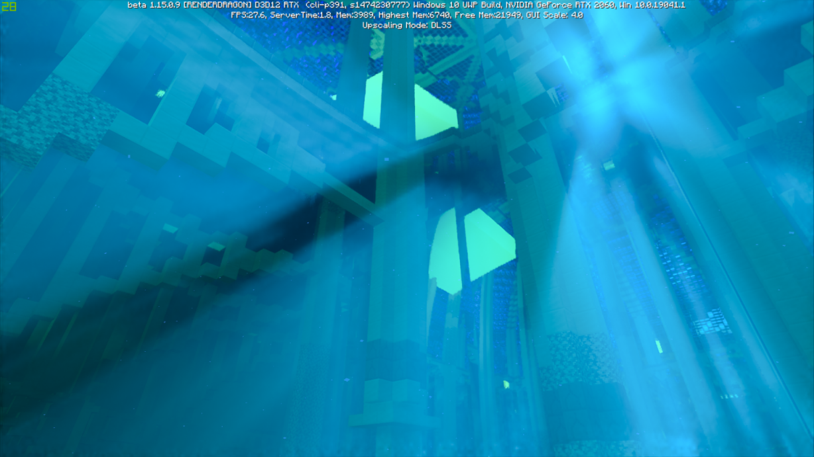

  [1]: https://www.chuhelan.com
  [2]: https://www.chuhelan.com/archives/301
