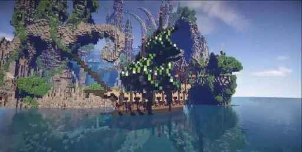
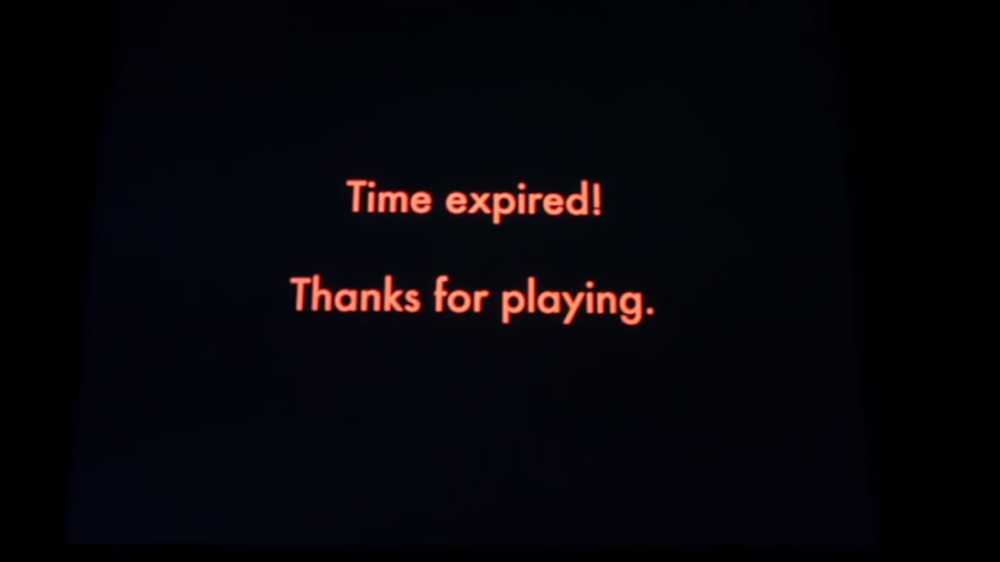

~~~txt
在我搓这篇水稿之前，花了一个半小时去看了由 2PlayerProductions 制作的纪录片 Minecraft: The Story of Mojang，这是 Youtube 地址：https://youtu.be/ySRgVo1X_18
~~~
 
2009 年，Minecraft 在一间没人会注意的房间里被开发了出来，当时的 notch 也未曾想过，它将持续燃烧十年之久，甚至继续延续……
 
### 我的世界 / 我们的世界

（虽然由于网易的代理，导致“我的世界”这个译名被赋予了某些贬义意义，但是我依旧认为这是个非常好的翻译，它简单直观的表明了 Minecraft 的核心玩法）
Minecraft 的核心就是如今部分沙盒游戏所“追求”的**创造、生存**，这一条普通，甚至说简单的原则甚至至今没有改变，但是却构建了如今由 Minecraft 衍生的整个社区。而在当时游戏都已一种 **购买 - 了解任务 - 完成任务 - 吃灰** 的架构下，Minecraft 确实深深的颠覆了游戏，当然这儿并没有贬低 3A 大作的意思，就像 notch 所说的：
~~~
我只是想做些有趣的东西。
~~~
Minecraft 的模式就是生活的另一面，它没有明确的目标（成就系统只是为了引导玩家了解玩法），没有固定的玩法，你可以想干嘛就干嘛，你可以发挥你在现实生活中无法实现、被压抑的创造力。这就是它的核心玩法所带来的吸引力，它不像乐高玩具一样，拿出说明书拼完挂起来那么任务化。这就是为什么，这是个不是游戏的游戏，因为它已经衍生出了一个完整的平台……
Minecraft 所构建的平台不仅仅在游戏这个体系下，而是扩散为了一个完整的交流体系，很难有一个游戏可以有如此广泛的涉及到的从教育到地形设计、建筑设计、模数电设计到周边程序开发、艺术创作等多样性的内容。
 
### 你的世界 / 未来

但最终，这依旧是个游戏……
不管它有着多么广阔的平台，对于一个普通玩家来说，它依旧是一个游戏。notch 的离开也许是外界所说的“拿钱走人”，但我认为更多的是他在 Minecraft 的发展中已经体会不到他所要的“有趣”了，在一个由兴趣编写的游戏开始，他逐渐变的复杂起来，变得需要公关，需要宣传，需要去衡量儿童和家长的平衡性，需要去考量游戏所引起的社会影响，这不再是所谓兴趣设计的范围了，这不有趣了。
该醒了吗，我不知道，因为我只是个普通的玩家，我只需要认真的投入这个**创造、生存**的属于我自己的世界。

纪录片的最后一幕，是 MOGANG 在展览上的预览版本提示的“体验时间结束，感谢游玩”字样，不管这个游戏最后会怎样，感谢这个游戏被创造出来，也感谢所有玩家，我最终都会看着这个游戏直到落幕的，可能在十几年后，还能和早已忙碌在现实生活中的“小伙伴们”在深夜，谈谈我的世界。
