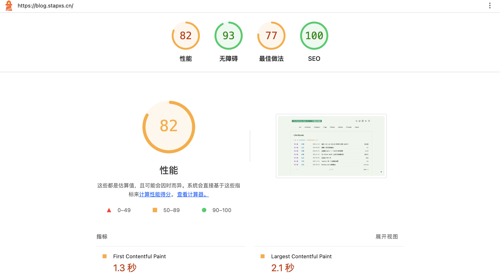
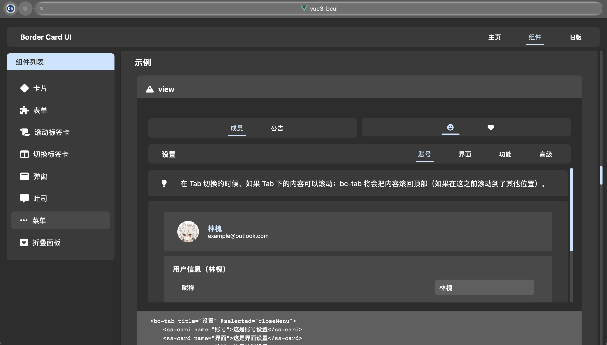
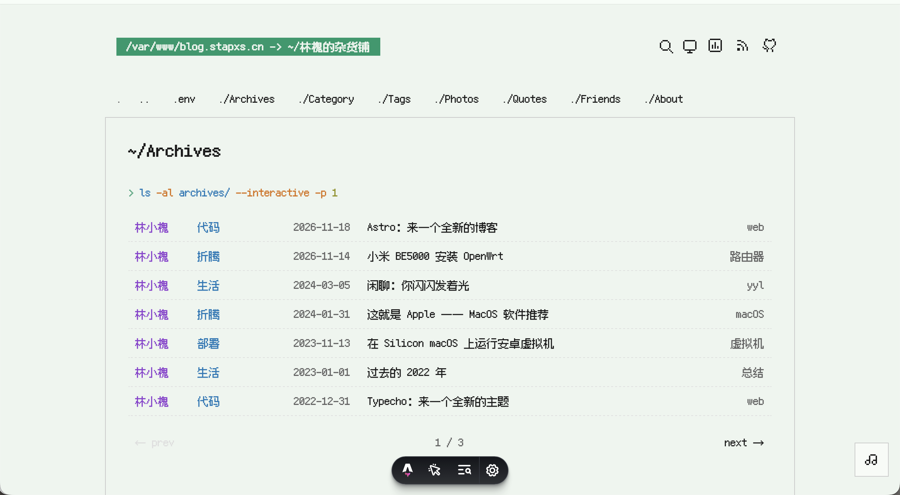
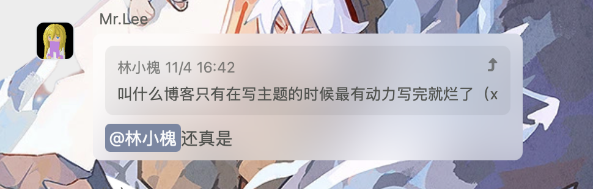

~~~
Minecraft 的 Pixel Genesis 专辑很好听，可惜我放这儿只有试听段 😭
~~~

总之—— 距离上次更新博客的主题已经有四年之远了，由于受够了各种大圆角大阴影的设计风格。
所以这次就做了个更终端风格的主题—— 把主要注意力放在图形和文本上让整个页面更扁平和一致性的风格化上。

为了让整博客更加轻量以及在迁移中有更灵活的部署可用性，博客的技术架构也从基于 PHP 的 Typecho 更换为了使用 Astro 生成的静态页面：一方面我对纯前端的开发更熟悉一点，同时 Astro 也有很大的自由度允许我对博客的整体内容和能力进行发挥和扩展。

所以这篇文章的主要侧重在吹一吹 Astro 在定制性上的能力，它其实对只想要写点文章的人来说有极高的上手门槛。

## 完整的前端项目
Astro 其实是一个静态页面生成框架并且恰好做了一些博客模板和博客需要的组件罢了，而不像其他一起比的产品是一个博客框架；这意味着其实你在面对一个完整的前端项目，并且有很大的灵活性去对这个项目做调整。

你可以看到很多不是博客的站点也由 Astro 制作，比如 cloudflare 的官网：https://cloudflare.com。

### 零 JS 框架，岛屿架构按需加载 JS
Astro 默认零 JS，它的构建逻辑会剥离所有客户端 JS 来避免你在开发中无意引入多余的脚本，这使得你可以很轻易的写出移动端友好并且 SEO 非常好看的站点。同时在需要动态运行的部分内容，构建期也会独立剥离按需加载 JS，让其他部分依旧保持静态。

### UI 框架无关
Astro 可以混用前端框架来开发，当然本博客全都使用 React 编写，因为我想学一学 React。但最终 Astro 都会将他们汇合到一起编译成静态 HTML，同时继续继承上一点的优点进行动态加载运行时。

### Markdown 处理器
Astro 默认提供 Sätteri 和 Unified 两款 Markdown 处理器，它们在新增语法、改链接或代码块的输出、给元素加属性等方面都有很强的自由性，这让对 Markdown 渲染的扩展非常的自由。后者的社区生态也不错，有很多现成的插件；前者比较新（现在 Astro 默认用它），生态略差但是性能比后者更好。

{: class=right}

在我这，链接卡片、标题 ID、Github Alerts 语法、Kramdown 语法支持都是通过插件来支持的：
https://github.com/Stapxs/Blog
> [!NOTE]
> https://markdown.land/markdown-alerts

## 林槐的杂货铺
好了！吹完了 Astro，现在该来说说这个项目……啊不是，这个博客。

### TUI? TUI!
我在很早以前写了一个基于卡片和大边距圆角的主题：Border Card UI，我其实还是蛮喜欢它的 emmmm 但是在近些年特别是最近被 AI 生成式 UI 风格的攻击，我开始对这种大边距的柔性设计风格产生了一些审美疲劳；再加上以前的主题信息密度极低，所以萌生了重写主题的想法。

关于之前的 BCUI 风格主题可以看这个：
[Typecho：来一个新的主题](/archives/bcui-typecho/)

那么既然要和圆角卡片和大边距说拜拜，那就很容易想到 UI 的另一个极端：TUI。它需要在一个限定的行列中以尽量高密度的方式显示足量的信息。（什么？你和我说 Sixel 协议和 Kitty Graphics Protocol？异端！抬出去！）

所以，嘿！我们来写个终端风格主题吧！不需要很严格的按照 TUI 去做，但是它可以做得很简洁、文本为主、紧凑，还能玩很多梗！一举多得。于是我就揣上我的 GPT 开干了.mp4

### 该有的总得有
这时候 Astro 的局限性就来了（x，它虽然提供了博客需要的功能像是 Site Map、RSS 等，但是没有国内博客常见三件套：音乐播放器、目录树、评论区。

默认的博客样式也没有分类、标签以及对应的筛选功能，再补充关于、友链之类的功能就基本上和之前一样了—— 这么一看国内的博客在社交性上还是比国外的博客更强一些（？

总之这样就大功告成了！很简单是吧（？

### 迁移
很显然—— 最麻烦的事情是迁移 😭 因为 Astro 的文章信息需要全写在 Markdown Frontmatter 里，把现有的文章处理成 markdown 文件、补充信息、微调整内容以适应新的布局顺便把新的灵感和 GPT 说—— 啊，没错我是在 GPT 改主题的同时做迁移的。

最后，部署上 waline（一个轻量的博客评论系统）再对它的样式进行一个大刀阔斧的改，然后让 GPT 对着俩数据库迁移下已有评论（不要学我让 AI 连接生产数据库，我有备份）。总之你看，AI 还是很好用的。

## 杂货
{: class=right}
杂货铺有了，还剩下文章了 emmm 虽然但是，总之我会开始尽量多写点东西的（慌张）。工作之后生活太单一了没有那么多有意思的事情要做所以很多东西都没了更新……

可能还是会主要写一些倒腾东西的文章？我不好说（瘫

## 我也想用！
首先很抱歉我没有把主题独立拆成插件XD 这真的很麻烦，所以整个样式都是嵌在 Astro 的代码里的。

如果你要缝进自己已有的博客里可能会略微微的有那么一点点的痛苦，所以—— 如果你感兴趣的话，上面的文章里已经出现过博客的代码仓库卡片了（相信你已经看到了）。
