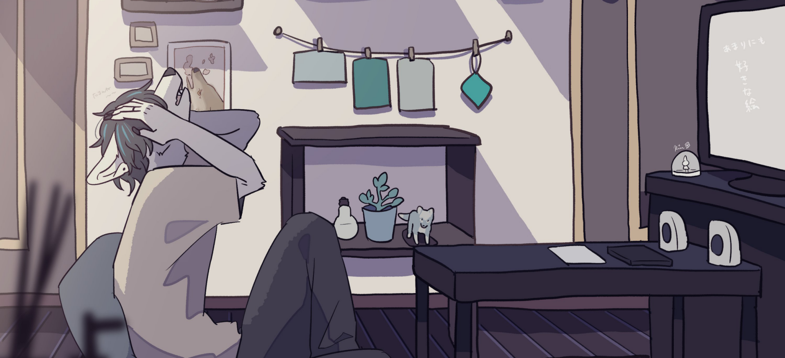
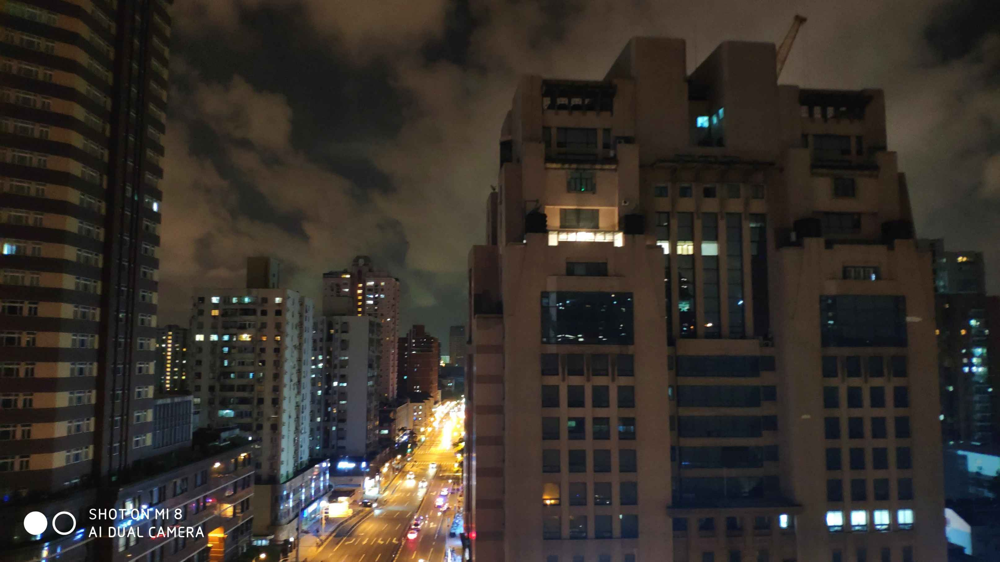
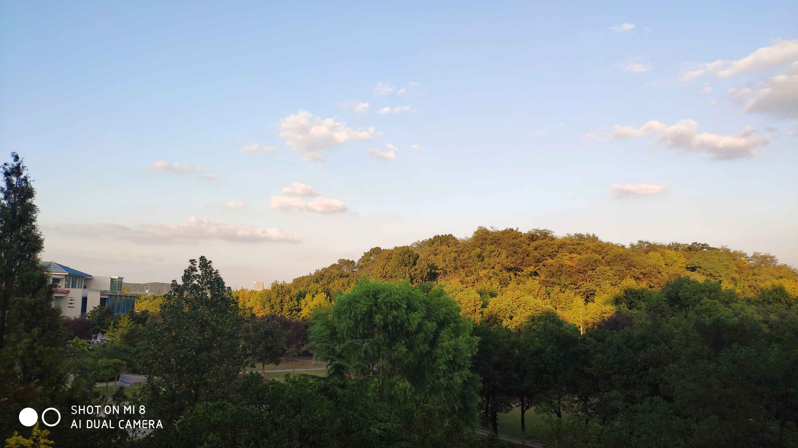
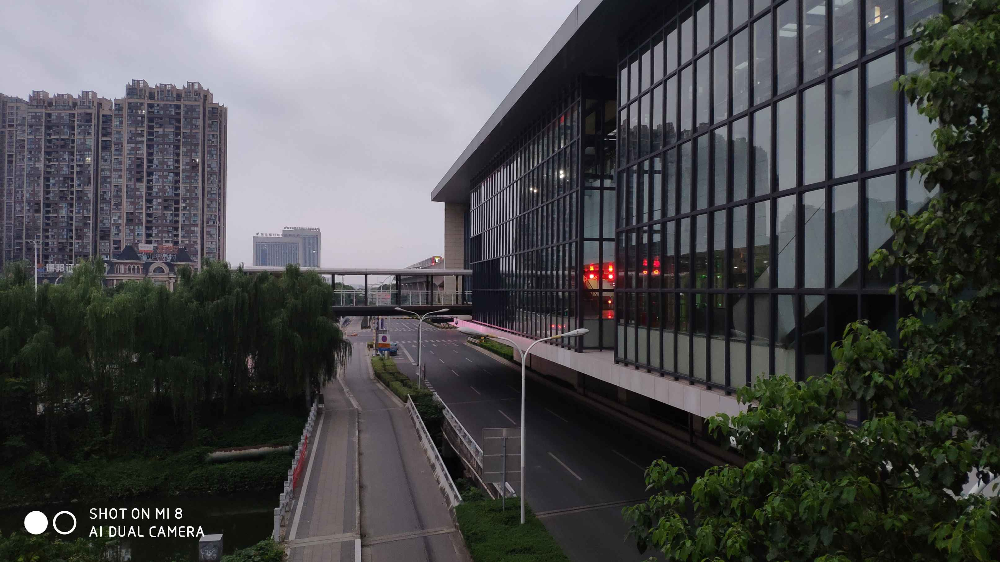

> [!NOTE]
> 顶图来源：https://twitter.com/rinrinwolf/status/1257827522542137345

2019年06月，SS高中毕业了。怀揣着对接下来生活的那么一点点的向往，活着。到现在发生了很多，有愉悦的或是郁闷的、也有欣喜的或是失落的、或者是向往的和追忆的……不管最终怎么了，也不管接下来会怎么样，至少我明白了不少东西，也理解了不少的事情。
## 发生了什么
2019年04月
- SS第一次有了喜欢的人，这件事情发生的很突然，以至于我懵了好久……SS很少会提“爱”这个字眼，因为它很沉重，我会很认真的去衡量这个字，它可能对我来说很重要，虽然我也不知道是不是。不过不管这些，我还是接受了……SS很不擅长观察生活和身边的人……或许这也是变相的自私吧，其实我很害怕的……

2019年08月
- 上海，我来到了这个城市，和他两个人。SS很喜欢这个城市……它让我第一次感受到了靠在栏杆上看海的感觉，也让我感受到了俯视城市的感觉。它也让我明白了一种从未体会到的情感……或许着也是SS第一次对所谓的未来有一些所谓的向往。

2019年09月
- 南京，SS终于去了大学，怀揣着上面一点点的向往去了。大学生活就目前对SS来说还是太乏味了（注意不是枯燥）,没有什么我认为有意义有趣的事情能做，虽然讨论有没有意义本来就没意义。虽然至今为止，真的超级无聊……想了半天也没想到啥有意思的 = =，但不管怎么样，也是一段新的生活吧。

2020年01月
- 除夕夜，整个世界都塌了。这是我这一年唯一一次哭，也是我三年里第一次失眠。我知道这都是我的错。第一次体验到了純白P的《我的海岸线》歌词中“昨天还是晴朗的你，今天发现只是梦境”的感觉……

2020年03月
- 有了自己的服务器和blog，敲快乐的。

也就这些东西能让我记忆深刻，其他的也不想去想了。SS不喜欢回忆往事，就像《可塑性记忆》里香月说的“人就是这样的”，快乐的回忆只有存在的时候才会是快乐的……所以我选择直接埋掉。所以很多事情我可能都已经不记得了 = =，因为我真的不想去记住它们。
## 明白了什么
负能量
- 即使我明白这个破世界是有多么的破，但是这不应该作为一个输出源输出……它会影响到和你在一起的每一个人。
照顾好自己
- 连tm自己都照顾不好自己你还在想靠谁呢。这是SS至今为止犯的最大的错误……
观察世界
- SS其实很不擅长感情方面的东西……所以我尝试着用自己的方式观察着交际圈里的人，去用我的方式理解着，在《我讲个笑话，你可别哭啊》里有一句“一定要尊重一个，你不懂的人。”而在朋友中，可能更需要理解。
用心说话
- SS其实非常害怕伤害到别人……所以SS对任何人都有一层自动保护，事实上我才发现这其实起着很严重的反作用……
没有说什么意味深长的东西，但是就是这么简单。我错了，错了很多；明白了，但是没用了。

## 尾巴
既然仓库里的东西都埋掉了，那就把仓库弄弄干净，继续塞新东西吧……你说埋掉的东西？哪天挖到再说。

