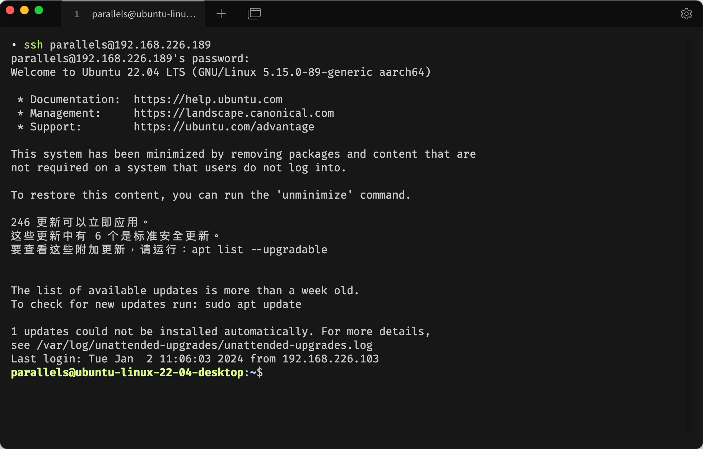
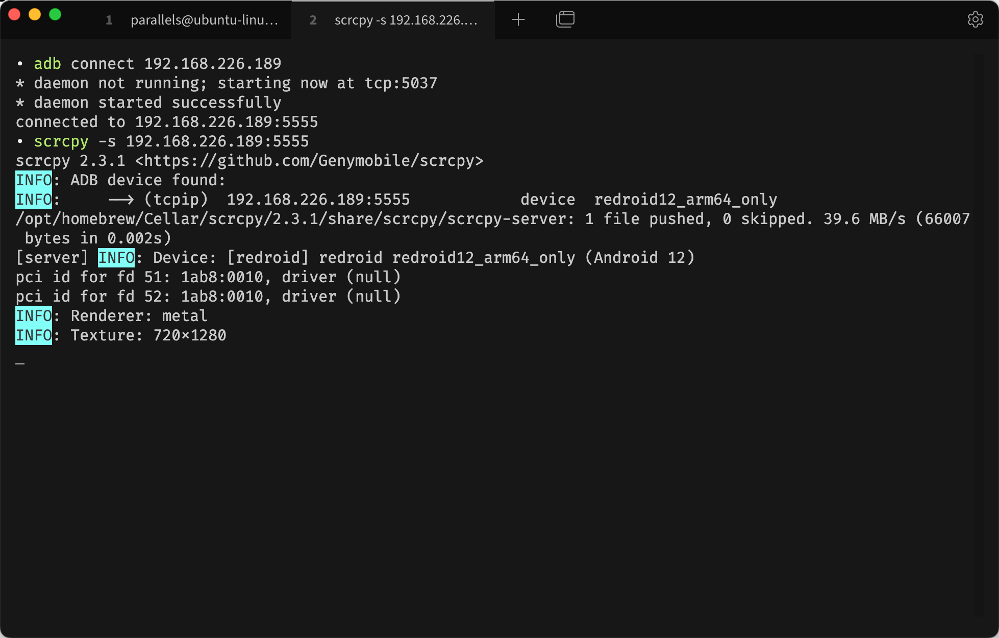
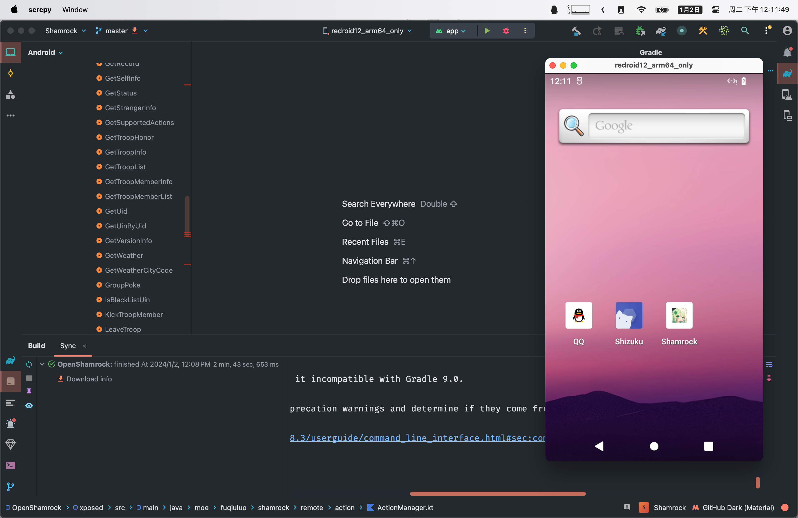

因为要进行一些安卓开发的活计，Android Studio 自带的安卓虚拟机不支持使用硬件 GPU 加速。无奈为了更好的性能跑去用了 redroid。
redroid 是个可以运行在 Docker 容器中的安卓虚拟机，它可以调用来自系统的硬件 GPU 来跑出更完整的性能（甚至运行游戏）。

https://github.com/remote-android/redroid-doc

### 安装 ubuntu 虚拟机
因为 redroid 只能在 ubuntu 的宿主环境下跑 …… 在 MacOS 下就得脱裤子放屁的再套一层 ubuntu 的虚拟机（恼，在本篇文章中我使用了 Parallels Desktop，当然你也可以选择用 VirtualBox 之类的。
总之，部署虚拟机的部分就直接跳过了：

### 准备 Docker
- 安装 Docker
redroid 可以直接运行在 Docker 中，我这儿直接使用 Docker 的官方脚本进行了一个安装，当然如果国内网速实在堪忧，你也可以去找找镜像的安装脚本：
~~~shell
curl -fsSL https://test.docker.com -o test-docker.sh
sudo sh test-docker.sh
~~~

- 检查安装情况
安装完成之后 Docker 会启动并注册为启动服务。输出容器列表查看 Docker 的运行状态：
~~~shell
sudo docker ps
~~~

- 启用需要的内核
redroid 需要一些内核功能，需要注意的是这些内核功能在每次启动虚拟机之后都需要启用。
~~~shell
# 安装 linux 内核工具
apt install linux-modules-extra-`uname -r`
# 启用内核功能
sudo modprobe binder_linux devices="binder,hwbinder,vndbinder"
sudo modprobe ashmem_linux
~~~

### 运行 redroid
由于 Silicon 是纯 64bit 架构，它没法运行带有 32bit 版本的 redroid；这意味着你只能运行安卓 12 及以后版本的 redroid（因为在这之前没有 64bit only 的版本）。
直接使用 Docker run 运行 redroid 容器：
~~~shell
sudo docker run -itd --privileged \
    --name redroid-12 \
    --pull always \
    -v ./data:/data \
    -p 5555:5555 \
        redroid/redroid:12.0.0_64only-latest
~~~
使用最高权限运行它主要是为了让它可以直接调用系统硬件。

### 连接 redroid
等待容器正常启动后，你就可以使用 adb 和 scrcpy 连接它了：

如果出现 `Network is unreachable` 的错误，关闭容器回到上面开启内核功能的部分确认下是否已经启动。

### 使用虚拟机
接下来你就可以用 adb 的方式和平常一样使用它了！

