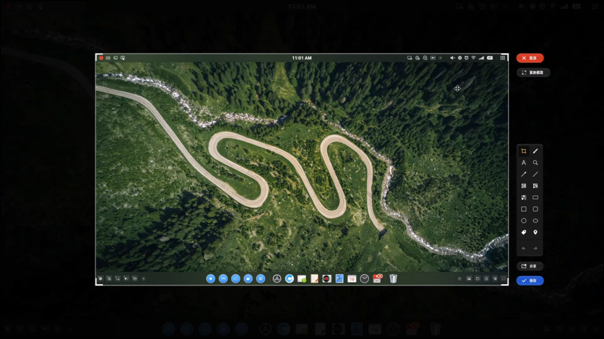
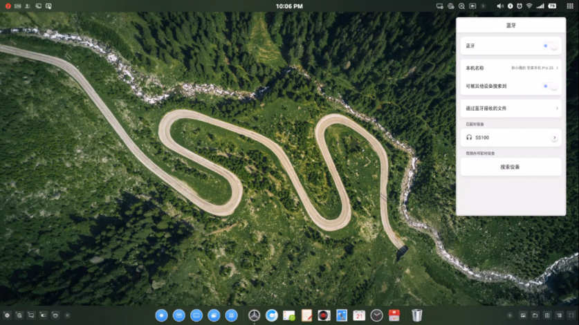
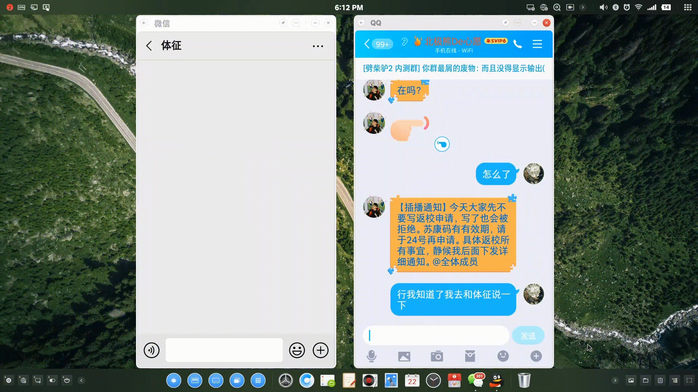
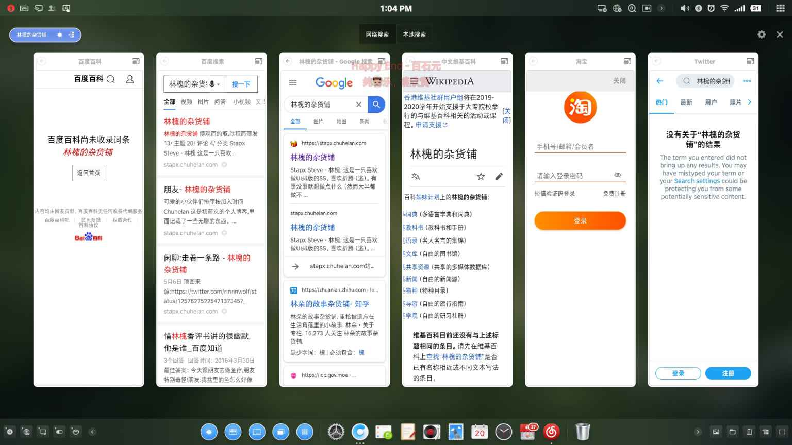
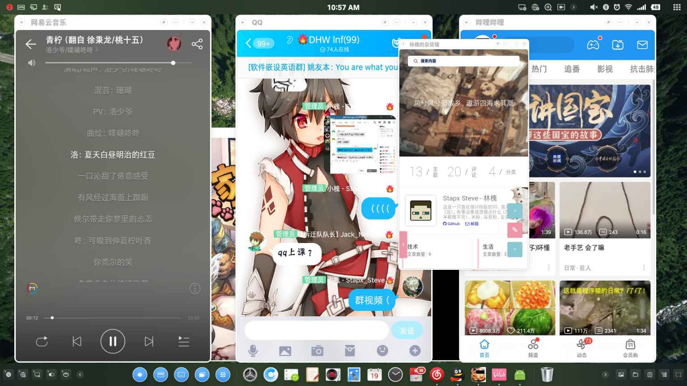

{: class=right}

虽然TNT在Smartisan OS 6.6的时候就已经发布并且可以使用了。但是因为财力等多方面的影响，直到去年年底我才入了一台坚果Pro 2S，直到坚果Pro 3也就是Smartisan OS 7.0发布后，期待了好久好久的Pro 2S更新7.0之后，我才算勉强体验上了 —— Smartisan TNT。所以，这个继承自老罗的，还没有太大妥协的，所谓颠覆PC的东西，到底怎么样呢。

### 整体
对于桌面安卓，在如今其实已经有了不少的选择。从Android X86衍生的凤凰系统、Remix OS这种X86平台安卓，到基于Chrome OS的Fyde OS，以及和TNT一样的来自华为、三星等其他厂商的“桌面模式”。桌面安卓在人们并不重视，甚至是所谓没什么用的注视下，一点点的发展着。
而TNT给我带来的第一感受就是，这是个认真做的东西。这是个认真的询问你使用那种键盘布局，认真的将所有系统UI适配大屏，认真的处理操作逻辑的系统。虽然它并不是特别完美，但是，它认真了。

###### 适配大屏的系统 UI

TNT整体外观依旧沿用了老罗的设计，不知道是什么原因，TNT暂时还没有加入Smartisan OS 7.0的去老罗化队列里，任务栏和通知栏使用了类Mac的毛玻璃居中。左下快速搜索（全局搜索，闪念胶囊），右下快速浏览（相册，文件，剪贴板的侧滑栏），左上通知，右上状态。整体透露着一股轻盈的风格。桌面壁纸和SOS一样，提供了一套横屏系统壁纸。
当然这样看是相当美观的，不过点开一些项目时，就略微差强人意了。一些状态项目的详情页面似乎只是单纯的弹出了设置界面的窗口，让我感受到了一股冲突感，一种“它是单个窗口而不是属于状态栏”的感觉。

###### 蓝牙详情页

仔细审阅TNT，美中不足，甚至是逻辑有误的地方很多，比如说支持改变窗口大小的窗口和不支持的标题栏大小不一样，消息提示打断标题栏的浮动窗口，模拟触控板没有左右单击按键（长距离拖动会很难受），展开应用列表界面卡顿，视频输出只支持1080P和4K等等。有些可能只是视觉上的不适，但有些确实带来了实质上的操作困难。
虽然说TNT可能是目前同类“桌面模式”里做的最好的，但它还是距离“最好”很远，很远。

###### 模拟触摸板

### 一步 & 大爆炸
得益于大屏幕多窗口，一步和大爆炸的配合工作得到了一个质的飞跃，跨窗口拖拽文本，图片异常的方便。而大爆炸更类似于全局复制一样的启动模式，不过我还是得吐槽一下单独弹窗而不是覆盖显示在复制窗口上的事情。
（gif加载可能略慢）

###### 跨窗口拖拽

### 全局搜索（发牌手）
老罗在发布会上非常认真的介绍了全新的交互模式 —— 语音，不过说实话，用语音打开关闭APP对于我这种懒得翻应用列表开APP的人来说真的是巨**方便！而同样基于语音的被称为发手牌的全局搜索也应运而生。

将语音搜索的多平台结果，像发牌一样（事实上动画确实就是这样的）展现在你面前，它能提供搜索平台（百度，搜狗，404），百科平台（百度百科，404），社交平台（微博，404，404），视频平台（爱奇艺，404）等平台的搜索结果。

### 其他
其实能说的还有不少，比如说坚果文档、子弹短信等，这些都是不错的点子，但是这些东西可能还不够完善，没达到我所谓的能用级别；或者是因为种种原因，这个功能已经被冲淡在历史中了。不是不提，而是不能提或者没法提了。

###### 多窗口

### 尾巴
乔布斯曾经说过，那些疯狂到自己认为可以改变世界的人，才是真正改变世界的人。即使老罗已经不再了，但我相信总会有人默默的向往着改变世界，因为我们都还活着。TNT还远远不够，这个世界也还远远不够。

> [!NOTE]
> 文章截稿 SOS 版本：
> Smartisan OS 7.0.1.1 （坚果 Pro2S）
> 参考资料：
> https://www.bilibili.com/video/BV1vJ411B7tw
> https://www.smartisan.com/tnt/os
