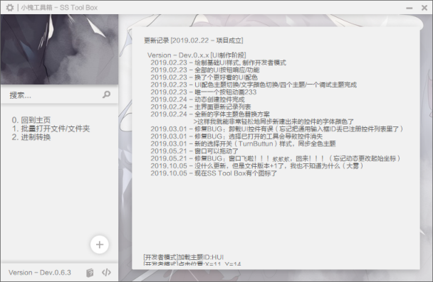
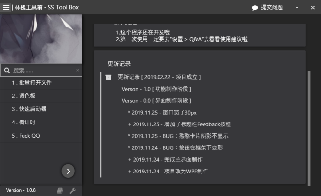
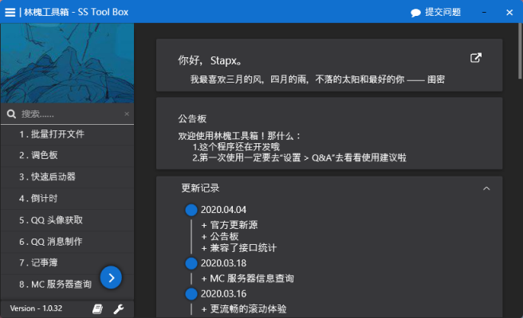
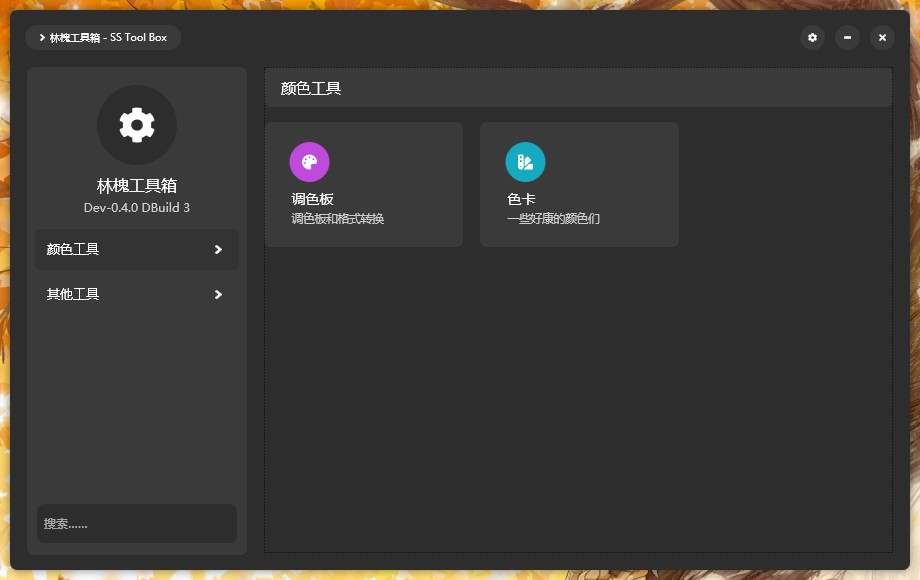

这是一个很早很早前写的工具箱的……重制版……最初写这个工具箱是想将各种日常要用到的零零碎碎的功能整合到一起，方便使用。emmmm然后就开始无限重构（大雾

## 历史

### Dev Version
这是早期的版本（初版），使用了纯 Windowss API 来制作，当时正在学 Windows API ，也是第一次接触 UI 编程。
因为这个版本单纯是设计理念的完善，完全就没有做功能 = = ，所以就没啥说的啦，顺带一提…… WinAPI 敲程序真的超累超累的（逃
康康亚子：

### Bata Version
这就是目前的版本啦，使用了 WFP 来制作，同上……当时正在学 WPF，于是代码写的超级糟糕，UI 层面的 BUG 就超多，别说功能了 QAQ

### 1.1
这是第一个正式版 ——，因为命名规则的疏忽，所以正式版被排到了 1.1，对大量 UI 的代码和结构进行了重构，虽然说有些陈年老代码不想看，导致基本结构依旧乱七八糟的，但是由于分页面的写法，所以新写的页面就比较工整啦，旧的代码也会逐步调整的。（界面看起来没啥变动啦）

### 2.0
这是全新设计的 SSTB！重写了各种东西，更漂亮也更强大！

## 关于
咳咳，这是林槐工具箱（SS Tool Box），这是一个可能没什么用的工具箱，它有着并不是特别好看的界面，有着并不是特别规范的代码，有着看起来非常鸡肋的彩蛋。但是这些都不重要，重要的是，它是 SS 第一个用来学习和练习 WPF 应用的程序。

/\* 以上是官方介绍（大雾 \*/

GitHub 地址 ： https://github.com/Stapxs/SS-Tool-Box

### 获取
你可以在 [林槐下载库][5] 或 [Github Releases][6] 获取到当前的最新正式版本，或者在 [Github][7] 的 Dev 分支获取最新的 Dev 版本。

  [5]: /lib
  [6]: https://github.com/Stapxs/SS-Tool-Box/releases
  [6]: https://github.com/Stapxs/SS-Tool-Box
