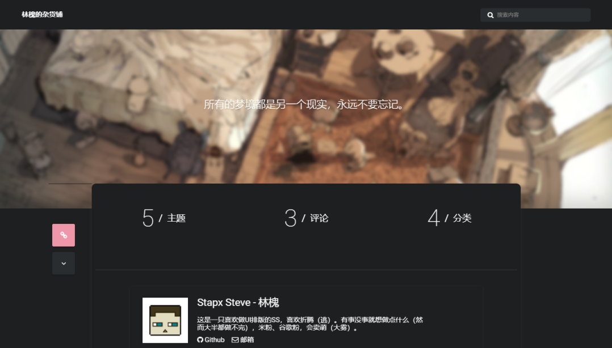
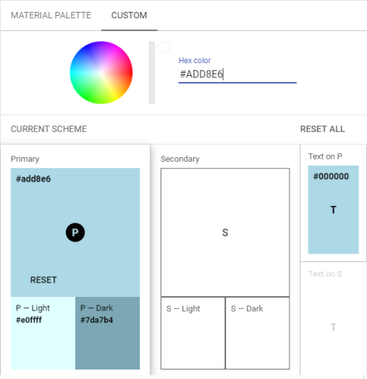
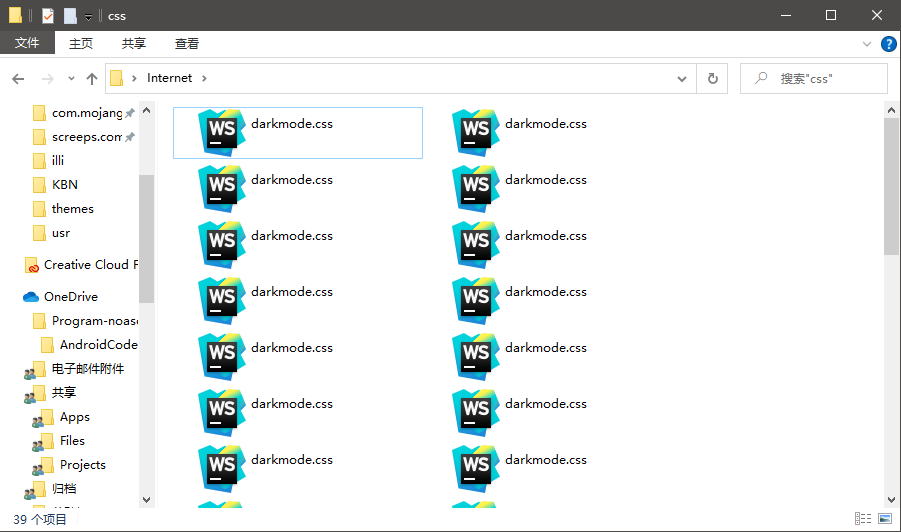

在 SS 日益完善自己的 BLOG 之后，于是就开始追求起了更多的功能，在瞎逛的时候看到了别人的暗黑模式~~就流下了口水~~，于是自己研究了下，主要分为以下两部分：
### 自动切换
因为现在这个主题其实已经把可用空间排满了，其他地方放开关也不好康，于是就打算直接做成根据时间切换，去查了下 PHP 获取时间，可以这么处理：
~~~php
    date_default_timezone_set('PRC');         //设置时区
    $hour = date('H');   
~~~
那么我们就可以判断获取到的小时参数来处理颜色模式了。
### 替换颜色主题
替换颜色主题部分其实很简单，根据 CSS 的覆盖原则（ [ 原文 ](https://www.cnblogs.com/Nyan-Workflow-FC/p/10419468.html) ）
- 规则一：由于继承而发生样式冲突时，最近祖先获胜。
- 规则二：继承的样式和直接指定的样式冲突时，直接指定的样式获胜。
- 规则三：直接指定的样式发生冲突时，样式权值高者获胜。
- 规则四：样式权值相同时，后者获胜。
- 规则五：!important 的样式属性不被覆盖。

我们可以直接在页面底端加载 CSS 来覆盖页面上面部分的全部 CSS 样式， 保险起见我们用 !important 样式来强制覆盖现有样式，所以我们就可以把上面的自动切换代码和 CSS 加载代码组合起来放在每一页都会被加载的 footer.php （就是底栏）里面，做到覆盖全页面。

~~~php
<?php
    date_default_timezone_set('PRC'); 
    $hour = date('H');   
    if($hour < 6 || $hour >= 18){
        echo '<link href="/usr/themes/illi/css/darkmode.css" rel="stylesheet"/>';   
    }
?>
~~~
按照上面的代码，页面将会在晚上 18 点到明天早上 6 点间启用暗黑模式，当然因为加载方式的原因在跨点的时候需要刷新生效。
### DarkMode.css
最后编写用于覆盖页面样式的 “DarkMode.css” 这是最简单的事情，也是最累的活，把页面上所有的元素的 CSS 样式进行重写覆盖，将浅色用深色替换，这儿我用了谷歌 Material Design 开发者工具里的 [Color Tool][3] 进行 Light 颜色和 Dark 颜色的转换。值得一提的是这也是谷歌为数不多可以在国内打开的页面。

~~~css
/*
暗黑模式 CSS 样式配置 by Stapx Steve
适用于 Typecho 主题 illi（预发行版 0.1）/ https://github.com/touchitvoid/illi
使用 Material Design 配色工具进行颜色转换 /  https://material.io/design
*/
	body {
		background-color: #1D1F20 !important;
		color: #FFFFFF !important;
	}
	.start {
		background-color: #1D1F20 !important;
		box-shadow: 0 1px 7px -1px rgba(203,143,154, 0.16);
	}
	text {
		color: #FFFFFF !important;
	}
	p {
		color: #FFFFFF !important;
	}
    ……
~~~
于是，经过一个多小时的整理，SS 写完了用于 illi 主题的暗黑模式 CSS 覆盖文件，如果你恰巧也使用了这个主题，可以直接拿去用：[/usr/themes/illi/css/darkmode.css][5]
~~~css
/* 主暗黑色调 */
background-color: #1D1F20 !important;
/* 辅暗黑色调 */
background-color: #292D2F !important;
~~~
### 题外话
你微软资源管理器和 FTP 一起，总能给你些惊喜 ——

### 尾巴
虽然花了不少时间，虽然做完之后有一点点的小 BUG，但不管怎么样，还是很满意的，还是很有成就感的，认真去做一件事情真的很快乐，也真的很舒服。
