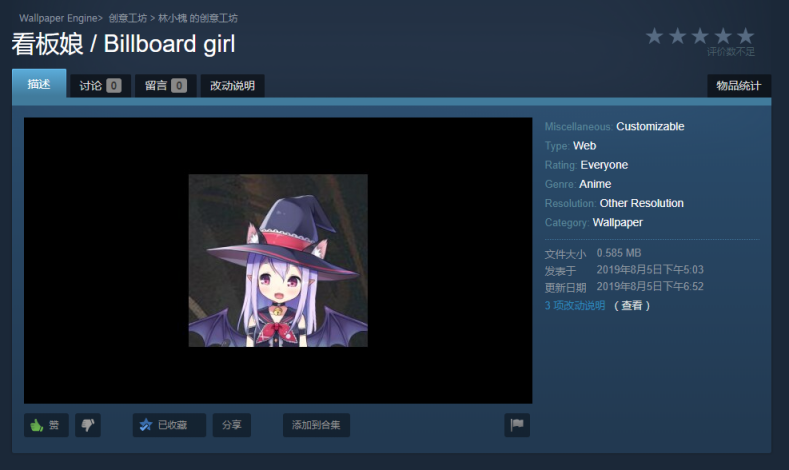

（此系列同暗黑模式 / 大雾）
在2019 年 8 月的那个风和日丽的下午，我折腾了三天的看板娘 Wallpaper Engine 动态壁纸移植版被发布到了 Steam 上，那时候正好是各大博客开始流行看板娘的时候，于是我扣代码搞成了壁纸。
然后我又给它扣了回来（（（（

### 精简版
因为我并不想要默认看板娘那些控件，所以需要个精简版，差不多只要以下代码就行了，这些代码来自[这儿](https://www.cnblogs.com/fofade)。
~~~HTML
<!-- 看板娘-->

<!---->

    <canvas id="live2dcanvas" width="240" height="480"
            style="position: fixed; opacity: 0.8; left: 0px; bottom: 0; z-index: 99999; pointer-events: none;"></canvas>

~~~
因为代码量真的少就拿来用了，其中部分变量的意义差不多是这样的：
~~~json
"display": {
            "superSample": 2,
            "width": 100,                //看板娘实际渲染宽度
            "height": 220,               //看板娘实际渲染高度
            "position": "left",          //悬浮对齐的方向
            "hOffset": 0,                //侧面外边距
            "vOffset": -20               //底面外边距
        },
"mobile": {
            "show": true,                //手机界面是否显示
            "scale": 0.5                 //透明度
~~~
然后这个是 canvas 的属性，被我省略为了三句：
~~~css
style
    position: fixed;                    //叠层样式，用来悬浮左右对齐的
    z-index:9999;                       //Z 轴位置，用来置顶
    left: 0px;                          //canvas 的位置
~~~
讲完了变量意义，就可以无脑把这个代码塞到网页里去了，理论上说塞哪儿都无所谓的，我塞在了 header.php 里面，然后检查看了下 —— 这个 canvas 是会挡到你点击后面的东西的，然后我突然发现……其实这个 canvas 是多余的，因为 Live2D 的那个 js 会自己创建一个 canvas 并且放置到你上面设置好的位置上，所以直接删掉它好了，OK，现在所有问题都解决了。

### 完整版
其实这个精简版的看板娘就是去除了聊天面板和 Tool Bar ，而完整版就来自于我调用模型的 [API](https://live2d.fghrsh.net/demo/1.4.2/) ，你也可以在这边看见示例：https://stapx.chuhelan.com/Live2D，由于用法差cha不yi多dian，所以我就不说了，自己研究去（逃
不过说说这个 API，在上面精简版中，有一段 JSON：
~~~json
"model": {
            "scale": 1,
            "hHeadPos": 0.5,
            "vHeadPos": 0.618,
            "jsonPath": "https://cdn.jsdelivr.net/gh/Fofade/cnblogsThemes/live2dw/assets/z16.model.json"
        },
~~~
这里 jsonPath 就是模型，你也可以把这个 API 填入这儿， API 调用方式（不包括方括号）：
~~~
https://live2d.fghrsh.net/api/get/?id=[模型ID]-[服装ID]
~~~
在上面我的示例链接里，切换模型和服装已经设置成了顺序切换，所以一个个数着切换就能知道 ID 啦（被打

### 超大只 ——

