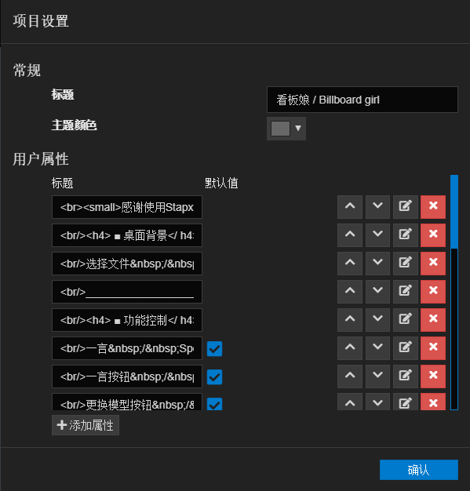
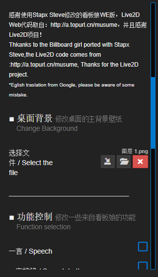

Wallpaper Enginer (简称 WE) 是一款强大的动态壁纸驱动应用，为什么说驱动呢，因为在 WE 中，动态壁纸按照实现类型分为以下几种：

- 靠 WE 自带的 2D 渲染完成的简单 2D 动画动态壁纸
- 通过 Web 方式实现的基于网页的动态壁纸，这也是 WE Steam 创意工坊中最多的一种形式
- 通过应用程序，这个是最少见的一种。

由于以上的特点，导致 WE 几乎可以实现大部分你想要的效果，而在所有的实现中，都需要通过某种方式将壁纸实现与 WE 本身进行设置项的沟通，壁纸实现告知 WE 显示何种设置，而 WE 则告知壁纸实现设置项目的改变。

本文就主要说基于 HTML Web 实现的动态壁纸该如何编写设置文件以及如何交互。

### JavaScript

HTML 由于其静态的实现方式，需要依靠 JS 代码进行操作，比如更改对象颜色，隐藏对象等，而网页接收到 WE 的设置变更后也是靠 JS 代码进行修改参数的。

### project.json

Wallpaper Engine 的壁纸设置项以一个 JSON 文件保存在壁纸目录内，结构基本上如下：
```json
{
	"contentrating" : "Everyone",
	"description" : "简介",
	"file" : "Main.html",
	"general" : 
	{
		"properties" : 
		{
			"Ch_OneCl" : 
			{
				"fileType" : "image",
				"order" : 102,
				"text" : "<br/>",
				"type" : "file",
				"value" : ""
			}
        }
    },
    "preview" : "preview.png",
	"tags" : [ "Anime" ],
	"title" : "m'c",
	"type" : "web",
	"visibility" : "public",
	"workshopid" : "1825724280"
}
```
这个 JSON 包含了壁纸的全部信息，包括分级、分类、名称、介绍以及完整的设置内容等，当然一般情况下不需要去手动编辑这个文件，因为你可以通过 WE 自带编辑器来生成（不过自动生成的名称会很长很长，不方便后期使用，可以手动修改。）



当然，因为设置页面其实也是基于 HTML 的，所有可以在设置标签里使用大部分 H5 的标签。

### 监听设置

WE 会向你提供一个监听事件，你所有的操作将在这个事件内完成，监听事件如下，你可以使用 JS 在任何位置进行响应并处理操作。

```javascript
window.wallpaperPropertyListener={
    applyUserProperties: function(properties){
    // Todo : 处理事件
    },
};
```

所有待处理的设置变更都将会在 properties 对象下，可以直接使用 if 来判断：

```javascript
if(properties.Ch_OneCl) {
    // Todo : 做些啥——
}
```

那么这些设置变更对象是什么，就像上面的 properties.Ch_OneCl，其实这些设置就是上面提到的 project.json 文件中的 general 下 properties 下的设置控件 JToken 的键名:

```json
"Ch_OneCl" : 
{
	"fileType" : "image",
	"order" : 102,
	"text" : "<br/>",
	"type" : "file",
	"value" : ""
}
```

所以我在上面提到自动生成的名称会很长很长，不方便后期使用，可以手动修改。
而具体的设置值会在变更对象的 value 中。

剩下的就是在网页中的操作了。

```javascript
if(properties.ChBkg){
    image = properties.ChBkg.value;
    // 获取自定义壁纸
    document.body.style.backgroundImage = "url('file:///" + image + "')";
    }
    if(properties.Ch_OneCl){
    chat = properties.Ch_OneCl.value;
    if(chat)
        $("#chat").show();
    else
        $("#chat").hide();
    }
```

最后你就可以得到一个有着漂亮的设置界面和完善的交互的 Wallpaper Engine 动态壁纸了。


