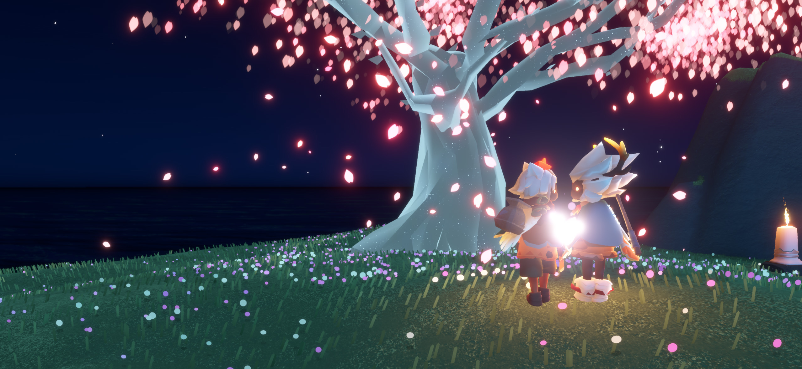

### 属于自己的世界

小猫猫有一个小小的世界，这个世界很简单也很干净。 
小猫猫小心翼翼的整理着这个小小的世界，这就是小猫猫的一切；它喜爱这这里的一切。

因为一直缺失社交，导致我一直怕人也很胆小……在结束了一些不太美好的社交之后，我也成功的毕业了。这意味着我可以选择自己要做什么而不用必须成为一群人的一部分了，我有了一份自己的工作一个人住了出去；我自由了，从某种意义上来说。
社交对我来说本来就是一件痛苦的事情，或许自己一个人做自己想做的事情是最好的吧——我经常失落的这么想。既然可以自己照顾好自己，或许已经很好了……

生活很枯燥，有时候我会想：这样的生活真的有必要吗。做着一些没有意义的事情，只是为了自己还活着…… 我观察着身边的每一个人，他们都匆匆忙忙的——做着自己在做的事情；有时候呆呆的看着身边的人，就好像自己并不是这个世界的一部分一样。

或许我确实不是这个世界的一部分吧——

### 不速之客

有一天，一只小狗狗一不小心闯入了这个小小的世界。 
小猫猫虽然很害怕，但是也十分好奇；小猫猫偷偷的观察着它……

生活中大部分人都是过客，我也是。多一个朋友也挺好的——我这么想着。
社交对我来说不是那么的刚需。我的情绪也很简单，也很容易沉浸到自己的世界里；很单纯的快乐、很单纯的伤心——为了自己；忘记一切时间、忘记一切事情，忘掉不开心的东西、忘掉周围的一切……虽然最后可能什么都没有做，但这就是我很简单的满足感。因此我也不擅长观察别人的情绪。

突然出现的热情让我很不习惯，但又不讨厌。
我从来没有遇到过……也不知道要怎么办。没事的，做自己想做的就好——我这样安慰着自己。

它热情友善的打量着这个小小世界里的每一个东西， 
它向小猫猫伸出了爪子——说道：“我们做朋友吧”， 
小猫猫把它留在了这个小世界里，就像这里面的其他东西一样。

我试着把这份热情收下并悄悄的传达给他，但是很多时候并不知道要怎么做……
我开始迷茫、开始怀疑自己、开始伤心、开始不知所措，沉浸在自己的情绪里忽视掉了一切。

我开始觉得自己真的收得下这份热情吗，开始觉得自己真的可以守护好这份感情吗……
开始觉得让他期待我真的值得吗，开始觉得让他把时间浪费在我的身上真的值得吗……

我是不是应该悄悄离开。

### 你闪闪发着光

埋在它松软的毛发里，小猫猫心想着这个小小的世界是不是有点太小了。 
小猫猫问它：“这个小世界真的那么好吗？” 
小猫猫有点不明白为什么它听完有点小生气……

或许是因为性格原因，我一直都有些自卑。一直觉得自己做不好一切……
也一直觉得自己配不上身边关心我的人、觉得自己辜负了帮助过我的人，也一直觉得自己做的事情不够负责。
所以我有时候会寻找……询问自己：凭什么、为什么

我明白答案并不重要……但我需要一个答案。

小狗狗好奇着这小小世界里的一切……和小小世界的主人， 
小猫猫享受着和他待在一起的每一刻时光……和他好奇的一切东西。

答案或许并不重要……因为答案就在身边。
答案就是我不需要拿出什么东西来证明我值得……因为这儿只有他，他就在这儿。

### 利爪与尖牙

猫猫不是什么时候都是软绵绵的，而狗狗也不是什么时候都可可爱爱的。 
利爪下手也会疼，尖牙下口也会痛； 
猫猫有时也忍耐着小狗狗的阴晴不定，狗狗有时也忍耐着小猫猫的冷漠随意。 
小打小闹有时或许也会酿成鸡飞狗跳……

我或许在某些方面比较幼稚和叛逆，但又不太擅长表达—— 最终导致的后果就是我很容易赌气和唱反调；
这其实是个很恶劣的行为，但是我经常阻止不了我自己这么干，
用最直接最少表达的方式来做“挣扎”和“抵抗”……用一种攻击性最强但是保护性最强的方式来保护自己

到最后才发现我用一种最疼的方式解决了问题，却无力挽回

小猫猫小心翼翼的抚摸着崩开的利爪， 
而小狗狗也舔舐着一道道伤口……  
纷争达成了妥协，而伤口总会留下不可磨灭的印记。

小猫猫或许知道自己做错了些什么，小猫猫偷偷的躲了起来……
在角落偷看着默默舔舐伤口的小狗狗
小猫猫鼓起了勇气……

……

## 我最亲爱的人

小猫猫并不在意断开的爪子，因为它依旧可以依靠在松软的毛发里； 
小猫猫问道：“我下手是不是太重了些”  
小猫猫舔了舔小狗狗的脸脸说道，”对不起嘛”

……

## 停驻的时间

……

……

